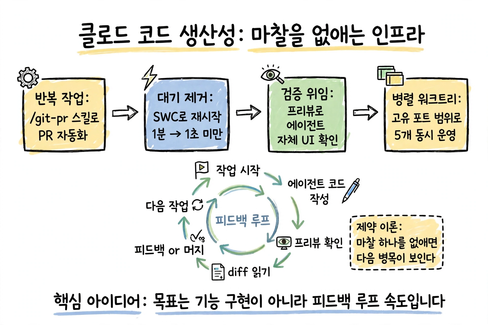
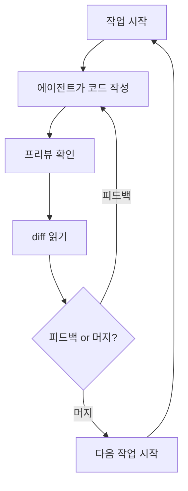
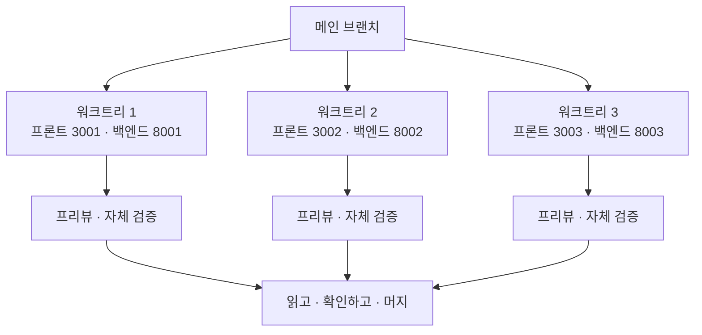

# 클로드 코드로 빨라지는 법, 프롬프트가 아닙니다. 마찰을 없애는 인프라입니다

> **Summary**
> 클로드 코드로 생산성을 높이는 비결은 프롬프트 기술이 아니라, 에이전트가 일하는 속도를 가로막는 마찰을 하나씩 없애는 인프라입니다. PR 자동화(/git-pr), 1초 미만 재시작, 에이전트의 자체 UI 검증, 포트 충돌 없는 병렬 워크트리 — 네 단계가 차례로 병목을 드러내고 없앴습니다. 결국 개발의 목표는 기능 구현이 아니라, 피드백 루프를 얼마나 빠르게 돌리느냐로 바뀝니다.

---

- 클로드 코드로 생산성을 높이는 비결은 프롬프트 기술이 아니라, 에이전트가 일하는 속도를 가로막는 마찰을 하나씩 없애는 인프라입니다.
- PR 자동화(`/git-pr`), 1초 미만 재시작, 에이전트의 자체 UI 검증, 포트 충돌 없는 병렬 워크트리 — 네 단계가 차례로 병목을 드러내고 없앴습니다.
- 결국 개발의 목표는 기능 구현이 아니라, 피드백 루프를 얼마나 빠르게 돌리느냐로 바뀝니다.


PR 하나 올리는 데 얼마나 걸리시나요? 변경 사항 스테이징하고, 커밋 메시지 쓰고, PR 설명 쓰고, 푸시하고, 깃허브에서 PR 만들고. 익숙한 순서죠. 그런데 이 순서가 전부 "잡일"이라면 어떨까요?

🎥 [동영상 보기](https://www.youtube.com/watch?v=S-sYlFiGFv8)

### 반복 작업, 왜 직접 하고 있을까요?

처음에는 모든 PR을 손으로 만들었습니다. 스테이징부터 PR 생성까지 전부요. 그런데 어느 순간 깨달았습니다. 이건 구현이 아니라 잡일이라는 걸요!

전환점은 역할의 변화였습니다. 구현자에서 에이전트를 관리하는 매니저로요. 매니저는 팀의 잡일을 자동화합니다. 그래서 첫 번째 스킬 `/git-pr`이 태어났습니다. 스테이징, 커밋 메시지, PR 설명, 푸시, PR 생성까지 한 번에 처리합니다.

놀라운 건 시간 절약이 아니었습니다. 에이전트가 전체 diff를 읽고 요약하기 때문에, 직접 쓰던 것보다 PR 설명이 더 상세해졌습니다. 진짜 수확은 정신적 오버헤드 제거였습니다. PR을 쓸 때마다 "코드 사고"에서 "코드 설명 사고"로 바뀌던 작은 컨텍스트 스위칭이 사라졌거든요. 이 부분이 가장 와닿았습니다. 시간을 아낀 것보다, 머릿속 전환 비용이 사라진 게 더 컸다는 말이요.

### 1분 대기가 흐름을 끊습니다?

다음 마찰은 대기였습니다. 로컬 프리뷰를 보려면 하던 일을 멈추고, dev 서버를 끄고, 새 브랜치에서 다시 켜야 했습니다. 서버 빌드에 약 1분이 걸렸습니다. 집중을 깨뜨리기엔 충분히 길고, 다른 일을 하기엔 너무 짧은 시간이었죠.

빌드를 `SWC`로 바꾸자 서버 재시작이 1초 미만으로 줄었습니다. 작은 변화처럼 들리나요? 전혀 아니었습니다! 파일을 저장하면 서버가 이미 올라와 있습니다. 주의력이 흐트러질 틈이 사라졌거든요. "어색한 침묵이 있는 대화"와 "자연스럽게 흐르는 대화"의 차이랄까요?

### 검증은 왜 개발자가 병목일까요?

모든 UI 변경을 직접 눈으로 확인해야 했습니다. 로컬 프리뷰를 열고, 보고, 기대와 맞는지 판단하고. 잘 돌아갔지만, 모든 기능의 병목이 개발자 본인이었습니다.

브라우저 확장 프로그램이 계속 크래시한 뒤, 클로드 코드의 프리뷰 기능으로 바꿨습니다. 에이전트가 프리뷰를 띄우고, 세션 데이터를 유지하면서, UI가 실제로 어떻게 보이는지 직접 확인합니다. 워크플로에도 박아 넣었습니다. 에이전트가 UI를 직접 검증해야만 "완료"로 처리하는 거죠.

검증을 위임하니 최종 리뷰에만 개입하면 됐습니다. 에이전트는 더 오래 자율적으로 실행됐고, 스스로 실수를 잡아냈습니다. 이게 생각보다 훨씬 큰 효과였습니다.

### 병렬로 일하면 왜 꼬일까요?

빠른 재시작과 자동 프리뷰가 갖춰지자 다음 마찰이 드러났습니다. 한 번에 하나의 작업만 편하게 할 수 있다는 점이요. 다른 에이전트나 팀원의 PR을 리뷰하려면 메인에서 브랜치로 체크아웃하고, 리빌드하고, 테스트해야 했습니다. 그런데 커밋되지 않은 변경과 충돌합니다. stash하고, 체크아웃하고, 리빌드하고, 테스트하고, 돌아오고, pop하고. 수동 워크트리를 만들면 포트 충돌이 터졌고요.

앱은 프론트엔드와 백엔드, 각각 별도 포트가 필요합니다. 모든 워크트리가 같은 환경 변수를 공유하니 같은 포트에 바인딩을 시도했습니다. 그래서 워크트리를 만들 때마다 각 서버에 고유 포트 범위를 자동 할당하는 시스템을 지었습니다. 동시에 프리뷰 10개를 띄워도 충돌이 없습니다.

두 개의 병렬 브랜치에도 압도되던 상태에서, 워크트리 5개를 동시에 운영하는 수준으로 바뀌었습니다. 계획 단계에 깊이 관여한 뒤, 코드 리뷰 시점까지 개입하지 않는 방식입니다. 리뷰도 훨씬 매끄러워졌습니다. 설정 작업도, 리빌드도, 포트 충돌도 없이 읽고, 확인하고, 머지하면 됩니다!

```mermaid
flowchart LR
    A[반복 작업<br/>PR 손수 작성] --> B[/git-pr 스킬<br/>포맷팅 마찰 제거]
    B --> C[1분 대기<br/>서버 재시작]
    C --> D[SWC 전환<br/>1초 미만]
    D --> E[UI 검증 병목<br/>개발자가 직접 확인]
    E --> F[프리뷰 기능<br/>에이전트 자체 검증]
    F --> G[병렬 작업 충돌<br/>포트·컨텍스트]
    G --> H[워크트리 시스템<br/>고유 포트 범위]
    H --> I[다음 병목 등장]
    I -.-> B
```

### 마찰 하나를 없애면 다음이 보입니다?

네 단계는 각각 다른 마찰을 없앴습니다. `/git-pr`은 포맷팅 마찰, `SWC`는 대기 마찰, 프리뷰는 검증 마찰, 워크트리 시스템은 컨텍스트 스위칭 마찰을요. 그리고 하나를 제거할 때마다 다음 병목이 즉시 드러났습니다. 제약 이론의 전형적인 패턴입니다!





### 그래서 뭐가 달라졌을까요?

작업의 본질이 바뀌었습니다. "코드를 써주는 도구를 쓰는 것"이 아니라, 작업 시작 → 에이전트 코드 작성 → 프리뷰 확인 → diff 읽기 → 피드백 또는 머지 → 다음 작업의 타이트한 피드백 루프입니다. 루프가 충분히 빠르면 주의력이 빠져나갈 틈이 없습니다.

한 가지 단서는 짚고 넘어가야 합니다. 커밋 수는 형편없는 성과 지표입니다. 원문에서도 직접 인정한 부분이고요. 커밋 그래프가 치솟은 건 결과이지 목표가 아닙니다. 목표는 루프 속도 자체였습니다.

역할도 바뀌었습니다. 복잡한 문제를 직접 풀고 완벽한 UI를 만드는 데 시간을 쓰던 자리에서, 에이전트가 효율적으로 일하게 만드는 인프라를 짓는 자리로요. 화려하지 않은 배관 작업이지만, 이 배관이 플로 상태에 머무를지 환경과 싸울지를 결정합니다. 10명 규모 팀의 매니저가 된 것과 비슷하다고 할까요?

속도가 빨라지자 게임 자체가 바뀌었습니다. 얼마나 더 빠르게 돌릴 수 있을까? 루프가 충분히 타이트해지면, 속도 향상 자체가 즐거움이 됩니다!

