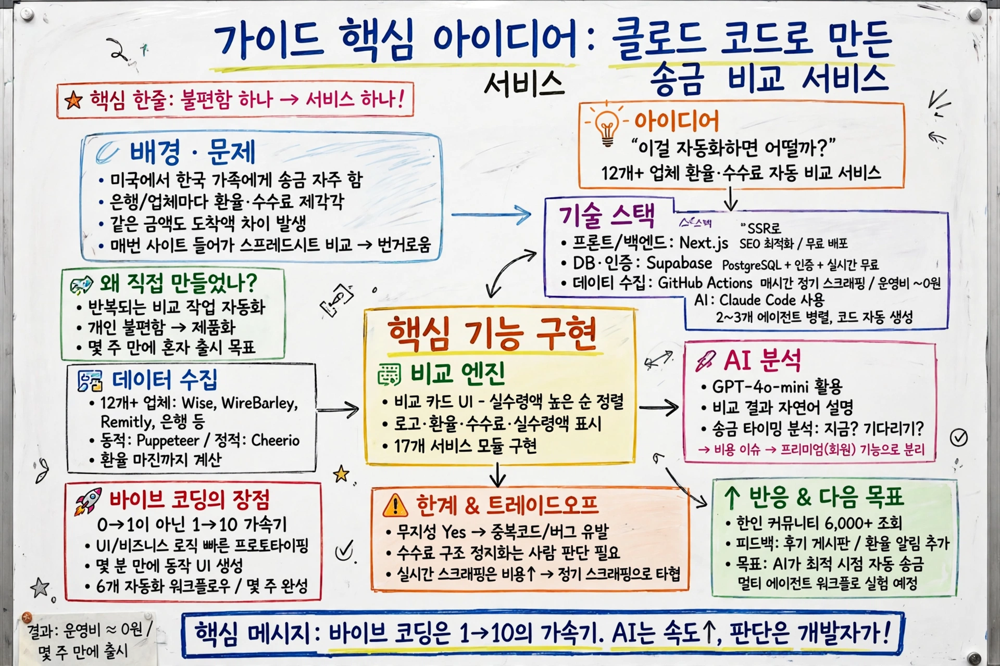
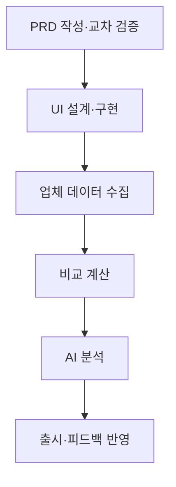
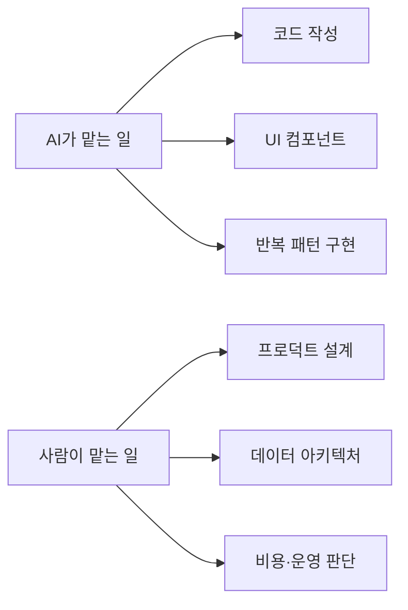

# 클로드 코드로 해외 송금 비교 서비스를 만들었습니다. AI는 1을 10으로 만드는 가속기입니다

> **Summary**
> 클로드 코드로 만든 해외 송금 비교 서비스는 개인적인 불편함에서 시작됐습니다. 12개 이상 업체의 환율과 수수료를 매시간 모아 비교하고, AI 분석으로 유리한 송금 옵션을 설명해 줍니다. 바이브 코딩으로 몇 주 만에 출시할 수 있었지만, 데이터 아키텍처 설계와 운영 비용 판단은 여전히 사람의 몫으로 남았습니다.

---

- 클로드 코드로 해외 송금 비교 서비스를 혼자 몇 주 만에 출시했습니다.
- 12개 이상 업체의 환율과 수수료를 매시간 모아 비교하고, AI 분석까지 붙였습니다.
- 바이브 코딩은 0에서 1을 만드는 도구가 아니라, 1을 10으로 만드는 가속기입니다.

미국에 살면서 한국에 있는 가족에게 돈을 보낼 때가 많았습니다. 부모님 생활비, 한국 계좌 관리, 경조사까지, 송금할 일은 자주 있었습니다. 그런데 은행마다 송금 업체마다 적용 환율이 다르고, 수수료 구조도 제각각이었습니다. 금액이 커지면 도착 금액 차이도 커졌습니다. 그래서 매번 업체 사이트를 열어 금액을 입력하고 스프레드시트에 정리해 비교했습니다. 그때 떠오른 생각이 "이걸 자동화하면 어떨까?"였습니다.

불편함 하나가, 서비스 하나가 됩니다!

🎥 [동영상 보기](https://www.youtube.com/watch?v=K2ce5mRJWVo)

## 왜 직접 만들었을까요?

송금할 때마다 가장 유리한 곳을 찾는 일은 반복됐습니다. 업체마다 환율도 다르고, 수수료도 다르고, 프로모션도 다릅니다. 같은 금액을 보내도 도착하는 돈이 달랐습니다. 손으로 비교하는 건 매번 번거로웠고, 그래서 아예 비교 자체를 자동화하는 서비스를 만들기로 했습니다. 개인적인 불편함에서 시작한 프로젝트였습니다.

## 어떤 기술로 만들었을까요?

사이드 프로젝트에서 가장 중요하게 본 기준은 출시까지의 속도와 운영 비용의 최소화, 두 가지였습니다. 만드는 데 오래 걸리면 동력을 잃기 쉽고, 수익이 불확실한데 운영비가 높으면 지속하기 어렵기 때문입니다.

그래서 스택은 이렇게 골랐습니다. 프론트엔드와 백엔드를 하나의 프로젝트에서 관리하고, 서버 사이드 렌더링으로 검색 최적화에 유리하며, 무료로 배포할 수 있는 `Next.js`를 선택했습니다. 데이터베이스와 사용자 인증은 `Supabase`로 해결했습니다. 무료 티어만으로 `PostgreSQL` 데이터베이스, 사용자 인증, 실시간 구독을 모두 쓸 수 있었습니다. 매시간 각 업체의 환율과 수수료 데이터를 모으는 일은 `GitHub Actions`에 맡겼습니다. 정기 스크래핑을 추가 비용 없이 돌릴 수 있었습니다. 결과적으로 도메인 구입비 빼고 운영비는 0원에 가깝습니다!

AI 코딩 도구는 클로드 코드를 썼습니다. 터미널 기반의 AI 코딩 도구로, 프로젝트 맥락을 깊이 이해한 상태에서 기존 구조와 코드 패턴에 맞는 코드를 써준다는 점이 장점이었습니다. `VS Code`와 `Warp` 터미널을 이용해 2~3개의 에이전트를 병렬로 돌렸습니다. 계속 일하게 만드는 랄프 루프도 써봤지만, 프로젝트 구조가 생각과 다르게 만들어지는 걸 보고 중단했습니다.

## 핵심 기능은 어떻게 구현했을까요?

먼저 `PRD`를 썼습니다. 클로드 코드와 제미나이를 함께 써서 교차 검증했습니다. 한쪽이 쓴 `PRD`를 다른 쪽이 리뷰하면서 빠진 요구사항과 논리적 허점을 잡아내는 방식이었습니다. 아키텍처와 단계별 계획도 이때 함께 문서화했습니다. UI는 `Figma`로 레이아웃과 컴포넌트 구조를 잡은 뒤, 클로드 코드로 실제 코드로 구현했습니다.

데이터 수집은 업체마다 방식이 달랐습니다. 동적 페이지는 `Puppeteer`로 브라우저를 띄워 실제 사용자처럼 금액을 입력하고 수취 예상액을 확인했고, 정적 페이지는 `Cheerio`로 파싱했습니다. 수집한 데이터는 DB에 저장하고, 기준 환율과의 차이도 함께 기록해 각 업체가 환율 마진을 얼마나 가져가는지까지 파악했습니다. 와이즈, 와이어바알리, 레밋리 같은 핀테크 업체와 시중 은행까지, 12개 이상 업체를 이렇게 모았습니다.

비교를 넘어 판단 근거를 주는 AI 분석도 붙였습니다. `OpenAI API`의 `GPT-4o-mini`로 두 가지 기능을 만들었습니다. 하나는 비교 결과 설명입니다. 왜 이 업체가 이 금액 구간에서 유리한지, 환율 마진과 수수료 구조, 현재 프로모션을 종합해 자연어로 설명해 줍니다. 다른 하나는 송금 타이밍 분석입니다. 최근 환율 추이를 보고 지금 보내는 게 유리한지, 기다리는 게 나은지 의견을 줍니다. 다만 저렴한 모델을 골랐는데도 API 호출이 늘면 비용이 무시할 수 없는 수준이 됐습니다. 무료 사용자에게까지 무제한으로 주면 수익 없이 비용만 늘어나는 구조였습니다. 그래서 AI 분석은 회원 가입이 필요한 프리미엄 기능으로 나눴습니다. 이건 기술 판단이 아니라 비즈니스 결정이었습니다!

## 바이브 코딩, 어디까지 잘 됐을까요?

가장 빛난 영역은 UI 컴포넌트 개발과 비즈니스 로직 생성, 그리고 빠른 프로토타이핑이었습니다. "비교 결과를 카드 형태로 보여줘. 실수령액 높은 순으로 정렬하고, 로고·환율·수수료·실수령액을 표시해줘"라고 말하면 `Tailwind CSS`가 적용된 컴포넌트가 바로 나왔습니다. 미세 조정은 필요했지만, 직접 코드를 쓰는 속도와는 비교가 안 됐습니다. "이런 레이아웃으로 비교 화면을 만들자"는 생각이 단 몇 분 만에 실제 동작하는 UI가 됐습니다.

비교 계산, 환율 관리, 스크래핑, AI 분석, 게시판, 이메일 발송, 구독 관리까지, 서비스 모듈이 17개나 됐습니다. 각 모듈의 기본 구조 위에 AI가 비즈니스 로직을 빠르게 채워 넣는 방식으로 진행했습니다. 데이터 파싱과 포맷 변환, API 응답 처리처럼 반복되는 패턴은 스킬과 문서로 제공해 일관된 코드를 만들었습니다. 12개 이상 업체 스크래퍼, 17개 이상 서비스 모듈, 6개 자동화 워크플로우를 혼자 몇 주 만에 구현했습니다. AI 도움 없이는 불가능한 속도였습니다!

## 어디서 막혔을까요?

무지성으로 Yes를 누르는 순간이 가장 위험합니다! 프로젝트 구조와 패턴의 일관성이 무너지고, 이미 만든 기능과 비슷한 중복 코드가 생겼습니다. 기존 기능과 UI에 버그가 생기고, 디버깅 시간도 점점 늘었습니다.

데이터 아키텍처 설계도 마찬가지였습니다. 12개 이상 업체의 수수료 구조는 정액제, 정률제, 환율 내재형까지 제각각입니다. 이걸 어떻게 정규화해 하나의 비교 테이블로 만들 것인가, 스크래핑 데이터의 이력은 어떻게 관리하고 최신 데이터는 어떤 기준으로 갱신할 것인가. 이런 문제에는 데이터베이스 지식이 필요했습니다. "송금 수수료 비교 시스템을 설계해줘"라고만 하면 AI는 일반적인 구조를 제안해 줄 뿐, 실제 업체들의 특수한 수수료 구조까지 반영한 설계는 사람의 판단이 필요했습니다.

서비스 운영 비용에 대한 판단도 같았습니다. 실시간 스크래핑은 기술적으로 가능했지만 비용이 들고 유지보수가 어려웠습니다. 그래서 송금 금액 구간을 나누고, 실시간이 아닌 정기 스크래핑으로 타협했습니다. AI는 대부분 이상적인 해법을 제시하는 경향이 있어, 이런 트레이드오프 결정까지 기대하기는 어려웠습니다.

## 반응은 어땠을까요?

미국 한인 커뮤니티에 제작기를 공유했더니 조회수 6,000회를 넘겼습니다. "다른 송금 업체도 더 추가해 달라", "업체별 사용 후기를 공유할 수 있으면 좋겠다" 같은 구체적인 피드백이 왔습니다. 그래서 2차 업데이트를 진행했습니다. 송금 정보와 업체 사용 후기를 공유하는 게시판을 추가했고, 원하는 환율 조건을 설정해 두면 조건이 충족될 때 자동으로 알려주는 로그인 기반 환율 알림 기능도 도입했습니다.

최종 목표는 더 큽니다. 사용자가 조건과 선호 기간만 설정해 두면, AI가 환율 흐름과 수수료 구조를 계속 관찰하다가 가장 유리한 시점에 가장 적절한 송금 서비스를 골라 자동으로 송금까지 처리하는 서비스입니다. 여러 AI 에이전트에게 코드 작성, 코드 리뷰, 테스트 생성 같은 역할을 나눠 맡기고 조율하는 멀티 에이전트 워크플로도 다음 업데이트에 실험해 볼 계획입니다.

바이브 코딩은 개발자의 생산성을 급격히 높여줬습니다. 다만 서비스를 온전히 출시하려면 기획, UI/UX, 마케팅, 보안, 운영에 대한 노하우가 필요합니다. AI가 코드를 대신 써주는 만큼, 개발자의 역할은 코드를 쓰는 사람에서 프로덕트를 설계하고 판단하는 사람으로 변해야 합니다. 불편함을 해결하는 작은 서비스 하나가 많은 사람에게 도움이 될 수 있습니다.

