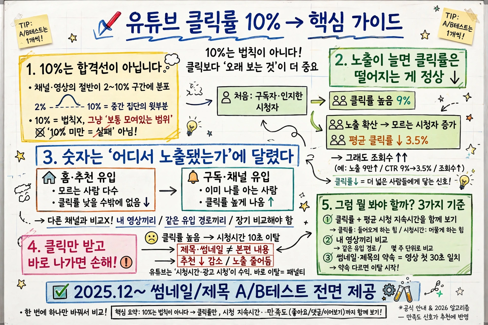
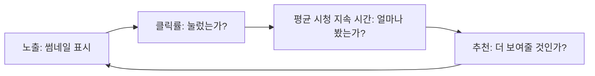
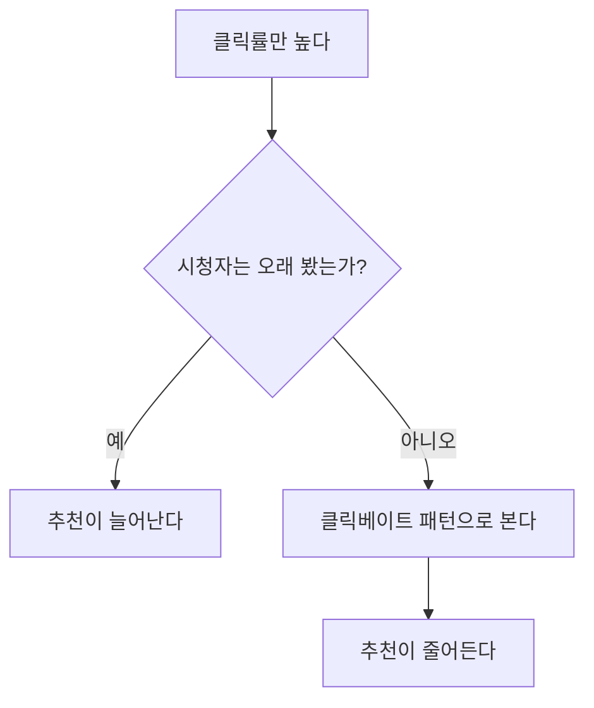

# 클릭률 10%는 더 이상 법칙이 아닙니다. 클릭보다 머무는 시간이 먼저입니다

> **Summary**
> 클릭률 10%는 유튜브의 합격선이 아니라 흔히 관찰되는 범위의 상단이며, 노출이 넓어지면 클릭률이 낮아져도 조회수는 늘 수 있습니다. 클릭률은 유입 경로가 같은 영상끼리 비교하고 평균 시청 지속 시간 및 시청자 만족도와 함께 살펴야 합니다. 제목·썸네일의 약속이 영상 내용과 맞아 시청자가 오래 머물도록 하는 것이 중요합니다.

---

- 클릭률 10%는 유튜브가 정한 합격선이 아닙니다. 채널·영상 절반이 2~10% 사이에 있을 뿐입니다.
- 노출이 늘고 시청자층이 넓어지면 클릭률은 떨어지는 게 정상입니다. 클릭만 받고 바로 나가면 추천은 더 줄어듭니다.
- 클릭률은 내 영상의 평균 시청 지속 시간과 함께, 같은 유입 경로끼리 비교해야 합니다.

썸네일을 밤새 고쳤는데, 클릭률이 4%에서 꿈쩍도 안 한 적 있으시죠? 제목도 바꾸고 색도 바꾸고 얼굴도 키웠는데, 숫자는 그대로였습니다. 그럴 때 머릿속에 떠오르는 말이 있습니다. "10%는 돼야 좋은 썸네일이라던데."

그 기준, 이제는 법칙이 아닙니다!

🎥 [동영상 보기](https://www.youtube.com/watch?v=wrIlifWnKDs)

## 10%라는 숫자는 어디서 왔을까요?

유튜브 공식 안내에 따르면, 채널과 영상의 절반은 노출 클릭률이 2%에서 10% 사이에 있습니다. 10%는 합격선이 아니라, 중간 집단의 윗부분에 가깝습니다. 나머지 절반은 그 바깥에 있습니다. 새로 만든 채널이나 일주일 안 된 영상, 조회수 100회 미만인 영상은 범위를 더 넓게 벗어나는 경우도 흔합니다.

그러니까 10%는 "여기까지 와야 한다"는 기준이 아니라, "대체로 이쯤에 모여 있다"는 관찰에 가깝습니다. 그런데 이 숫자가 돌고 돌면서 법칙이 됐습니다. 10% 미만이면 썸네일이 실패했다는 식으로 말이죠.

> 클릭률 10%는 목표가 아니라, 중간값의 끝자락이었습니다.

## 클릭률이 떨어지는데 조회수가 늘어난다고?

노출이 늘면 클릭률은 떨어지는 게 자연스럽습니다. 유튜브 공식 안내에도 그렇게 적혀 있습니다. 처음에는 내 영상을 아는 사람들이 주로 봅니다. 그런데 홈 화면에 자주 뜨기 시작하면, 나를 모르는 사람들까지 봅니다. 모르는 사람은 클릭을 덜 합니다. 그래서 평균이 내려갑니다.

유튜브 성장·발견 부문을 이끄는 책임자는 구독자에게 보여지는 영상조차 클릭률이 대체로 10% 이하라고 설명했습니다. 구독자 10명 중 9명은 눌러보지 않는다는 뜻입니다. 클릭률이 떨어졌다고 썸네일이 나빠진 게 아닙니다. 영상이 더 넓은 사람들에게 닿고 있다는 신호일 수도 있습니다!

한 사례에서는 노출이 9만 회 늘면서 클릭률이 9%에서 3.5%로 떨어졌습니다. 그런데 조회수는 함께 늘었습니다. 숫자는 떨어졌지만, 영상은 더 퍼진 겁니다. 이게 왜 중요할까요? 클릭률만 보면 실패로 보이지만, 전체로 보면 성공이기 때문입니다.

## 어디서 보여졌는지가 숫자를 정합니다

클릭률은 어디서 노출됐느냐에 따라 달라집니다. 홈 화면이나 추천 목록에서 본 사람은 나를 찾아온 사람이 아닙니다. 그냥 지나가다 본 겁니다. 클릭률이 낮을 수밖에 없습니다. 반대로 채널 페이지나 구독 피드에서 본 사람은 이미 나를 아는 사람입니다. 클릭률이 높게 나옵니다.

그래서 남의 채널과 내 채널을 같은 숫자로 비교하는 건 의미가 없습니다. 비교는 내 영상끼리, 같은 유입 경로끼리, 긴 기간으로 해야 합니다. 유튜브 공식 안내도 그렇게 권합니다. 첫 몇 시간의 숫자만 보고 판단하지 말라는 당부도 함께 있습니다.

| 유입 경로 | 클릭률이 낮은 이유 |
| --- | --- |
| 홈·추천 | 나를 모르는 사람이 지나가다 봅니다 |
| 채널 페이지·구독 피드 | 이미 나를 아는 사람이 찾아봅니다 |
| 검색 | 원하는 정보를 찾으러 온 사람이 봅니다 |

## 클릭만 받고 바로 나가면 손해입니다

클릭률이 높다고 다 좋은 건 아닙니다. 클릭은 받았는데 시청자가 10초 만에 나가면, 유튜브는 그 패턴을 따로 봅니다. 제목·썸네일과 내용이 다르다는 신호로 읽습니다. 이런 영상은 추천에서 멀어집니다. 클릭을 유도하고 실망을 주는 조합은, 결국 노출 자체를 줄입니다.

이 장면이 가장 인상 깊었습니다. 유튜브가 광고 회사라는 점입니다. 클릭 한 번이 아니라, 오래 보고 광고까지 보는 시간이 수익이 됩니다. 클릭만 받고 바로 나가는 영상은 광고도 안 보이니까요!

2025년부터 추천 방식도 바뀌었습니다. 클릭과 시청 시간 위에 만족도 신호가 얹어졌습니다. 좋아요·댓글 같은 반응, 설문 응답, 다음 영상까지 이어서 보는지가 함께 평가됩니다. 추천은 영상을 밀어내는 게 아니라, 시청자 한 명 한 명에게 맞는 영상을 끌어오는 방식에 가깝습니다. 그래서 "만족"이 숫자로 안 보이는 핵심이 됐습니다.

## 그럼 뭘 봐야 할까요?

기준은 세 가지입니다. 첫째, 클릭률과 평균 시청 지속 시간을 함께 봅니다. 클릭률은 "들어오게 하는 힘", 시청 지속 시간은 "머물게 하는 힘"입니다. 둘 중 하나만 보면 판단이 틀어집니다. 둘째, 내 영상끼리 비교합니다. 같은 유입 경로에서 나온 숫자끼리, 몇 주 단위로 봅니다. 셋째, 썸네일·제목의 약속이 영상 앞부분과 맞는지 봅니다. 약속과 다른 첫 30초가 이탈의 시작입니다.

도구도 있습니다. 2025년 12월부터 제목·썸네일 A/B 테스트가 전면 제공됐습니다. 한 번에 하나씩 바꿔서 비교하는 게 기본입니다. 여러 개를 동시에 바꾸면 무엇이 효과를 냈는지 알 수 없습니다.

한 가지 더 짚고 갈 점이 있습니다. 원문 아티클은 직접 읽지 못했습니다. 정책상 원본 페이지에 닿지 못해서, 유튜브 공식 안내와 2026년 알고리즘 관련 공개 자료로 내용을 재구성했습니다. 숫자는 공식 안내에서 확인한 것만 썼습니다.

클릭률 10%는 법칙이 아닙니다. 클릭보다 오래 보는 게 먼저입니다!

