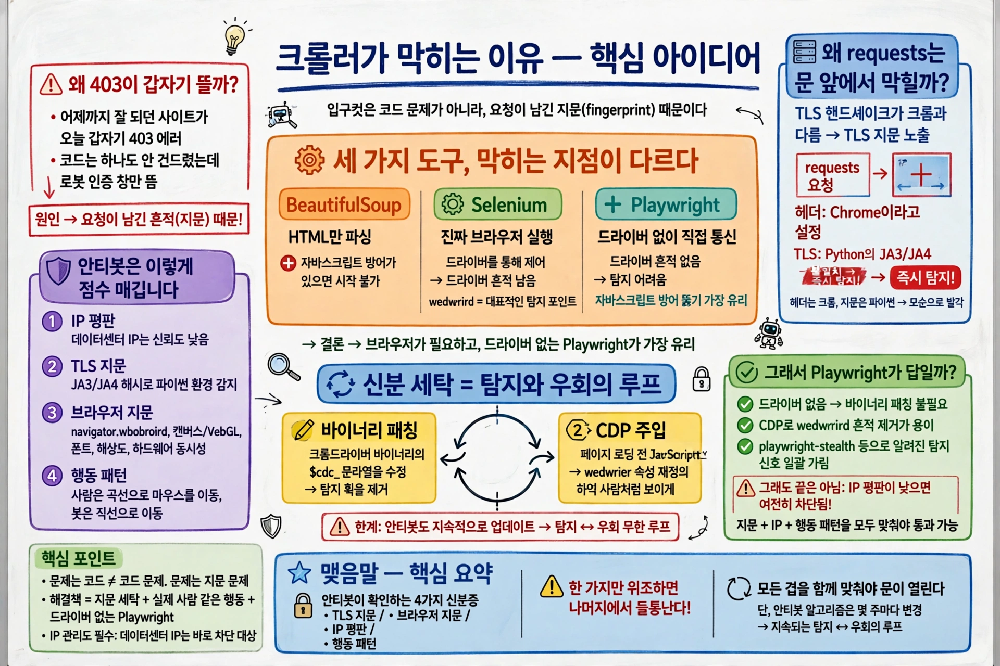
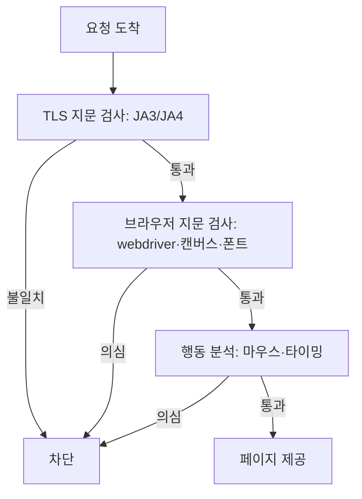
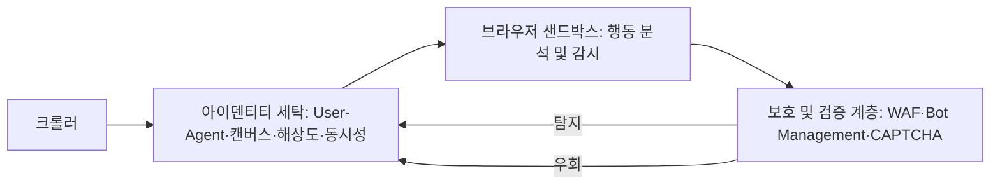
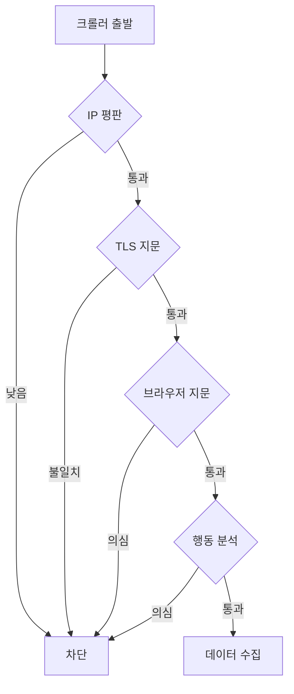

# 파이썬 크롤러가 자꾸 입구컷 당하는 이유, 문제는 코드가 아니라 지문입니다

> **Summary**
> 크롤러 차단은 코드보다 IP 평판, TLS·브라우저 지문, 행동 패턴의 불일치에서 비롯됩니다. 브라우저 자동화 도구마다 탐지 지점이 다르지만, Playwright는 드라이버 흔적이 적어 유리할 수 있습니다. 다만 안티봇 탐지와 우회는 계속 바뀌므로 한 가지 신호만으로는 차단을 피하기 어렵습니다.

---

- 크롤러가 막히는 이유는 코드가 틀려서가 아니라, 브라우저가 남기는 지문 때문입니다.
- 안티봇은 IP·TLS 지문·브라우저 지문·행동 패턴까지 여러 겹으로 점수를 매깁니다.
- 스레드에서 정리한 핵심은 지문을 가리는 세탁과 행동을 보는 샌드박스의 루프, 그리고 드라이버 없는 플레이라이트입니다.

어제까지 잘 긁히던 사이트가 오늘 갑자기 403을 뱉은 적 있으시죠? 코드는 하나도 안 건드렸는데 말입니다. 화면에는 로봇이 아니라는 걸 증명하라는 창만 뜹니다. 이럴 때 문제는 대부분 코드가 아니라, 요청이 남긴 흔적에 있습니다!

🎥 [동영상 보기](https://www.youtube.com/watch?v=tMj9r7NKVQQ)

### 왜 `requests`는 문 앞에서 바로 막힐까요?

`requests`로 보낸 요청은 헤더를 보기 전에 이미 들통납니다. TLS 핸드셰이크가 크롬과 다르기 때문입니다. 이걸 TLS 지문이라고 부릅니다. `JA3`·`JA4` 해시가 파이썬을 가리키는데, 헤더만 크롬이라고 적으면 오히려 모순이 됩니다. 헤더는 크롬, 지문은 파이썬. 안티봇은 이 불일치를 바로 잡아냅니다. HTTP/2의 헤더 순서와 프레임 설정도 마찬가지입니다. 그래서 `curl_cffi`처럼 브라우저의 TLS 지문을 그대로 흉내 내는 도구가 먼저 등장했습니다. 문을 두드리기도 전에 신분증부터 검사받는 셈입니다!

### 브라우저는 어떻게 봇을 알아챌까요?

TLS 검사를 통과해도 다음 관문이 기다립니다. 브라우저 지문입니다. `navigator.webdriver`라는 속성이 자동화의 가장 유명한 흔적입니다. 헤드리스 크롬은 이 값을 기본으로 켜고 다닙니다. 안티봇 스크립트는 페이지가 뜨자마자 이 값을 확인합니다. 여기에 캔버스 렌더링, WebGL 정보, 설치된 폰트, 화면 해상도, 하드웨어 동시성까지 더해지면 지문은 더 또렷해집니다. 마우스 움직임과 스크롤 속도 같은 행동 신호도 봅니다. 사람은 곡선으로 마우스를 움직이지만, 봇은 직선으로 움직이기 때문입니다.

### 세 가지 도구, 뭐가 다를까요?

파이썬 크롤러의 세 가지 도구는 막히는 지점이 다릅니다. `BeautifulSoup`은 HTML 텍스트만 파싱합니다. 자바스크립트 방어가 있는 사이트 앞에서는 아예 시작도 못 합니다. `Selenium`은 진짜 브라우저를 띄우지만, 드라이버를 통해서 조종합니다. 이 드라이버가 남기는 흔적이 탐지의 단서가 됩니다. `Playwright`는 드라이버 없이 브라우저와 직접 통신합니다. 그래서 드라이버 흔적 자체가 없습니다. 스레드에서 정리한 결론도 같습니다. 자바스크립트 방어를 뚫으려면 브라우저가 필요하고, 브라우저를 쓸 거면 드라이버 없는 쪽이 유리합니다!

| 도구 | 방식 | 막히는 지점 |
| --- | --- | --- |
| `BeautifulSoup` | HTML 텍스트 파싱 | 자바스크립트 방어 앞에서 시작 불가 |
| `Selenium` | 드라이버로 브라우저 조종 | 드라이버 흔적이 탐지 단서 |
| `Playwright` | 드라이버 없이 직접 통신 | 드라이버 흔적이 없음 |

### '신분 세탁'은 어떻게 할까요?

스레드의 다이어그램 제목은 "엔지니어링 전쟁: 지속적인 탐지와 우회의 루프"입니다. 크롤러가 지문을 가리는 과정을 "아이덴티티 세탁"이라고 표현했습니다. 방법이 두 가지 소개됐습니다. 첫째는 바이너리 패칭입니다. 크롬 드라이버 실행 파일 안에 박힌 `$cdc_` 같은 문자열을 런타임에 고쳐서 탐지 훅을 지웁니다. 둘째는 CDP 주입입니다. 페이지가 렌더링되기 전에 자바스크립트를 주입해서 `webdriver` 속성을 재정의합니다. 브라우저가 스스로를 사람이라고 말하게 만드는 방식입니다. 그런데 두 방법 모두 한계가 있습니다. 안티봇도 업데이트되니까요. 그래서 탐지와 우회는 루프로 돕니다.

### 그래서 플레이라이트가 답일까요?

상당 부분 그렇습니다. 드라이버가 없으니 바이너리 패치 자체가 필요 없습니다. CDP로 브라우저와 직접 통신하면서 `webdriver` 흔적을 지우는 방식도 한결 수월합니다. `playwright-stealth` 같은 도구는 알려진 탐지 신호를 한 번에 가려줍니다. 그래도 끝이 아닙니다. IP 평판이라는 관문이 따로 있습니다. 데이터센터 IP는 처음부터 신뢰 점수가 낮습니다. 지문을 완벽하게 가려도, IP가 이미 찍혀 있으면 막힙니다. 한 겹만 고친 크롤러는 여전히 막힙니다. 모든 겹을 한꺼번에 맞춰야 문이 열립니다. 그 문도 영원하지 않습니다. 안티봇 알고리즘이 몇 주마다 바뀌기 때문입니다.

### 맺음말

입구컷은 코드 실력 문제가 아닙니다. 안티봇이 보는 건 신분증 여러 장입니다. TLS 지문, 브라우저 지문, IP 평판, 행동 패턴. 한 장만 위조하면 다른 장에서 들통납니다! 스레드가 그린 루프가 바로 이 이야기입니다. 탐지가 좋아지면 우회가 따라오고, 우회가 좋아지면 탐지가 다시 따라옵니다. 크롤러를 짤 때는 이 루프 안에 서 있다는 걸 먼저 기억하면 됩니다!

