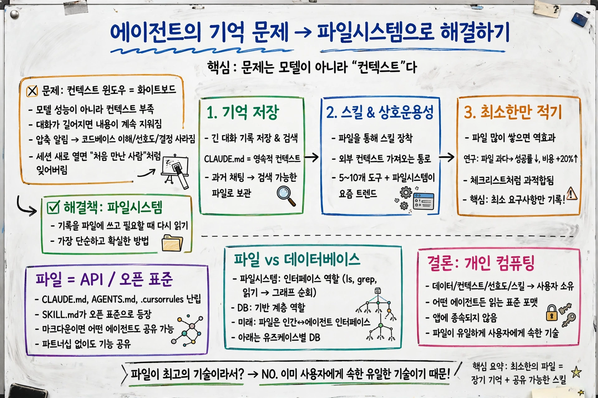
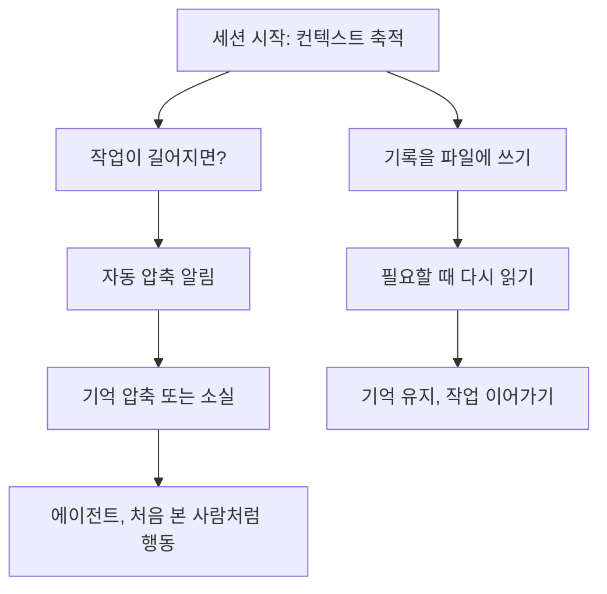
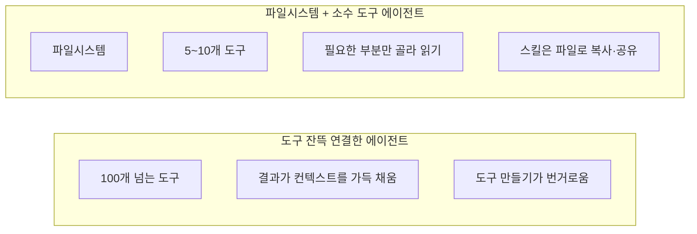
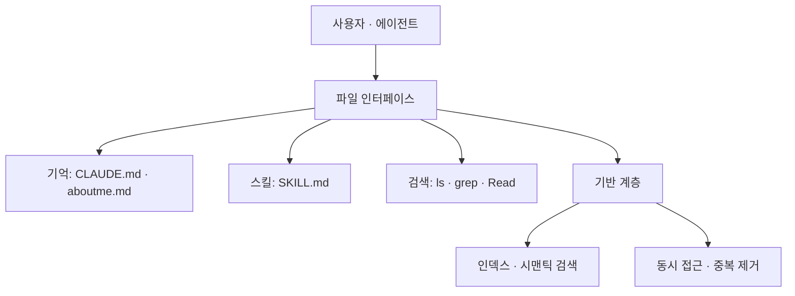

# 파일시스템이 다시 주목받는 이유, 에이전트의 기억은 파일에 저장됩니다

> **Summary**
> 에이전트의 기억 문제는 모델 성능이 아니라 컨텍스트에 있습니다. 컨텍스트 윈도우는 계속 지워지는 화이트보드에 가까워, 자동 압축이 뜨면 쌓아온 기억이 사라집니다. 파일시스템은 기록을 파일에 쓰고 필요할 때 다시 읽는 가장 단순한 해결책이며, 기억을 넘어 스킬과 상호운용성까지 담당하지만, 파일은 최소한만 적어야 합니다.

---

- 에이전트의 기억 문제는 모델 성능이 아니라 컨텍스트에 있습니다. 컨텍스트 윈도우는 계속 지워지는 화이트보드에 가깝습니다.
- 파일시스템은 이 문제를 가장 단순하게 해결합니다. 기록을 파일에 쓰고, 필요할 때 다시 읽으면 됩니다.
- 파일은 기억을 넘어 스킬과 상호운용성까지 담당합니다. 다만 파일을 많이 쌓는다고 좋은 건 아니고, 최소한만 적는 것이 핵심입니다.

코딩 에이전트에게 어제 하던 일을 이어서 해달라고 했는데, 어제는 알던 걸 오늘은 까맣게 잊어버린 적 있으시죠? 세션을 새로 열 때마다 에이전트는 처음 만난 사람처럼 굴었습니다. 똑똑한 건 맞는데, 기억을 못 한다는 게 문제였습니다.

🎥 [동영상 보기](https://www.youtube.com/watch?v=O0FGCxkHM-U)

## 컨텍스트 윈도우는 왜 기억이 아닐까요?

인간의 기억은 장기 저장, 선택적 회상, 불필요한 정보 망각을 함께 갖추고 있습니다. 그런데 LLM의 컨텍스트 윈도우는 이 중 어느 것도 제대로 못 합니다. 계속 지워지는 화이트보드에 가깝습니다.

코딩 에이전트를 쓰다 보면 "context left until auto-compact"라는 알림이 뜰 때가 있습니다. 이 알림이 다가오면 에이전트가 쌓아온 코드베이스 이해, 선호도, 결정 사항이 압축되거나 사라집니다. 세션이 길어질수록 기억이 옅어지는 구조입니다.

파일시스템은 이 문제를 가장 단순한 방식으로 해결합니다. 기록을 파일에 쓰고, 필요할 때 다시 읽으면 됩니다. 프로젝트에 대한 영속적 컨텍스트는 `CLAUDE.md`가 담고, 과거 채팅 기록은 검색 가능한 파일로 저장됩니다. 선호도와 작업 스타일을 담은 `aboutme.md` 파일은 이동 가능한 신원 기술자처럼 동작합니다. API 조율 없이 앱 사이를 옮겨 다닙니다.

## 파일은 에이전트에게 뭘 해줄까요?

파일이 에이전트에게 해주는 일은 크게 세 가지입니다.

첫째, 긴 대화 기록을 저장하고 검색합니다. 컨텍스트 윈도우가 지우는 기억을 파일이 대신 붙잡아 둡니다.

둘째, 외부 컨텍스트를 가져오는 통로가 됩니다. 기존의 단순한 검색 증강 방식은 원하는 답을 찾기엔 역부족이었습니다. 파일 검색 도구를 가진 에이전트는 사람처럼 파일을 훑고, 읽고, 따라가면서 답을 찾습니다. 소규모에서 중규모 문서 모음에서는 파일 검색만으로 단순한 시맨틱 검색을 앞지른다는 실험 결과도 있습니다.

셋째, 스킬을 장착하는 수단이 됩니다. 에이전트에게 새로운 능력을 주려고 매번 도구를 새로 만들 필요가 없습니다. 파일 하나면 충분합니다! 스킬은 파일이라 복사하기도, 공유하기도, 조합하기도 쉽습니다. 도구를 잔뜩 연결하면 컨텍스트 윈도우가 결과로 가득 차는데, 파일은 필요한 부분만 골라 읽을 수 있습니다.

그래서 요즘 흐름은 "수백 개 도구를 가진 에이전트 하나"가 아니라 "파일시스템과 5~10개 도구" 쪽으로 기울고 있습니다. 100개가 넘는 도구를 가진 에이전트보다 범용적일 수 있다는 주장까지 나왔습니다.

## 파일이 많으면 오히려 해가 될까요?

여기서 반전이 있습니다. 파일을 많이 주면 에이전트가 더 잘할까요? 한 연구팀의 실험 결과는 정반대였습니다. 컨텍스트 파일을 받은 에이전트는 태스크 성공률이 오히려 낮아졌고, 추론 비용은 20% 이상 증가했습니다.

파일을 받은 에이전트는 더 넓게 탐색하고, 더 많은 테스트를 실행하고, 더 많은 파일을 순회했습니다. 그런데 정작 수정이 필요한 코드에 도달하는 것은 늦어졌습니다. 파일이 에이전트가 지나치게 진지하게 따르는 체크리스트처럼 작동했기 때문입니다.

이 대목이 저는 가장 와닿았습니다. 파일을 늘리는 게 능사가 아니라는 점, 연구 결과가 직접 보여줬습니다! 논문의 결론은 "컨텍스트 파일을 쓰지 말라"가 아니라 "최소 요구사항만 기술하라"입니다. 문제는 파일시스템의 영속 계층 자체가 아니라, `CLAUDE.md`를 2,000단어짜리 온보딩 문서처럼 작성하는 관행입니다.

## 파일 포맷이 곧 API라고요?

지금 `CLAUDE.md`, `AGENTS.md`, `.cursorrules` 같은 컨텍스트 파일이 난립하고 있습니다. 에이전트에게 영속적인 파일 기반 컨텍스트가 필요하다는 점은 합의됐는데, 파일 이름과 내용 형식은 아직 합의되지 않았습니다.

그 와중에 Agent Skills(`SKILL.md`) 포맷이 오픈 표준으로 떠올랐습니다. 여러 대형 기업과 도구가 채택하면서, 한 도구용으로 작성한 스킬이 다른 도구에서도 작동합니다. 파일 포맷이 곧 API가 된 셈입니다.

이것이 조율 없는 상호운용성입니다. 두 앱이 마크다운을 읽을 수 있으면 컨텍스트를 공유할 수 있고, `SKILL.md` 포맷을 이해하면 기능을 공유할 수 있습니다. 파트너십 계약도, 표준화 기구 회의도 필요 없습니다. 파일 포맷 자체가 조율 역할을 합니다.

소셜 파일시스템이라는 아이디어도 같은 방향을 가리킵니다. 사용자 데이터를 개인 리포지토리 안의 파일로 취급하고, 도메인 네임 기반 네임스페이스로 충돌을 피합니다. 모든 앱의 데이터베이스는 그 파일들의 캐시된 뷰가 됩니다. 가벼운 개인용 에이전트 프레임워크도 "기능 대신 스킬" 모델을 택했습니다. 메신저 지원이 필요하면 모듈을 새로 만드는 게 아니라, 스킬 파일 하나가 통합 방법을 가르칩니다.

## 파일과 데이터베이스, 어느 쪽이 이길까요?

파일시스템을 쓰면서 에이전트에게 그래프가 필요 없다고 말하는 건, 사실 그래프를 쓰고 있다는 사실을 부정하는 것이라는 지적이 있습니다. 파일시스템은 디렉터리와 파일로 이뤄진 트리 구조, 즉 방향성 비순환 그래프입니다. 에이전트가 `ls`로 목록을 보고, `grep`으로 검색하고, 파일을 읽고, 참조를 따라갈 때 이미 그래프를 순회하고 있습니다.

그래서 승부를 가르는 구분은 이렇습니다. 파일시스템은 인터페이스로서 승리하고, 데이터베이스는 기반 계층으로서 승리합니다. 동시 접근, 대규모 시맨틱 검색, 중복 제거, 최신성 가중치가 필요해지면 결국 자체 인덱스를 만들게 되는데, 그건 사실상 데이터베이스입니다.

미래는 파일 대 데이터베이스가 아닙니다. 파일이 인간과 에이전트가 상호작용하는 인터페이스이고, 그 아래에 유즈케이스에 맞는 기반 계층이 위치하는 구조입니다. 에이전트에게 파일은 그냥 저장 공간이 아닙니다. 기억이자, 스킬이자, 인터페이스입니다!

## 이건 결국 개인 컴퓨팅 이야기입니다

파일시스템은 AI 시대에 개인 컴퓨팅의 의미를 재정의할 수 있습니다. 데이터, 컨텍스트, 선호도, 스킬, 기억이 사용자가 소유한 포맷으로 존재하고, 어떤 에이전트든 읽을 수 있으며, 특정 애플리케이션에 잠기지 않는 구조입니다. `aboutme.md`는 오늘의 도구에서도, 내일의 새 도구에서도 작동합니다.

다만 이상주의적인 측면도 있습니다. 개방 포맷의 역사에는 문서상으로 승리하고 실제로는 실패한 표준이 많습니다. 기업들은 자사 컨텍스트 파일을 미묘하게 다르게 만들어 전환 비용을 유지할 유인이 강합니다. `CLAUDE.md`와 `AGENTS.md`와 `.cursorrules`가 하나의 범용 포맷이 아닌 채 공존하는 것 자체가, 파편화가 기본값임을 보여줍니다.

> 우리의 기억·생각·디자인은 그것을 만든 소프트웨어보다 오래 살아남아야 합니다.

이것은 기술적 주장이 아니라 가치의 문제입니다. 파일이 최고의 기술이어서가 아니라, 이미 사용자에게 속한 유일한 기술이기 때문입니다. 그래서 파일이 다시 주목받고 있습니다!

