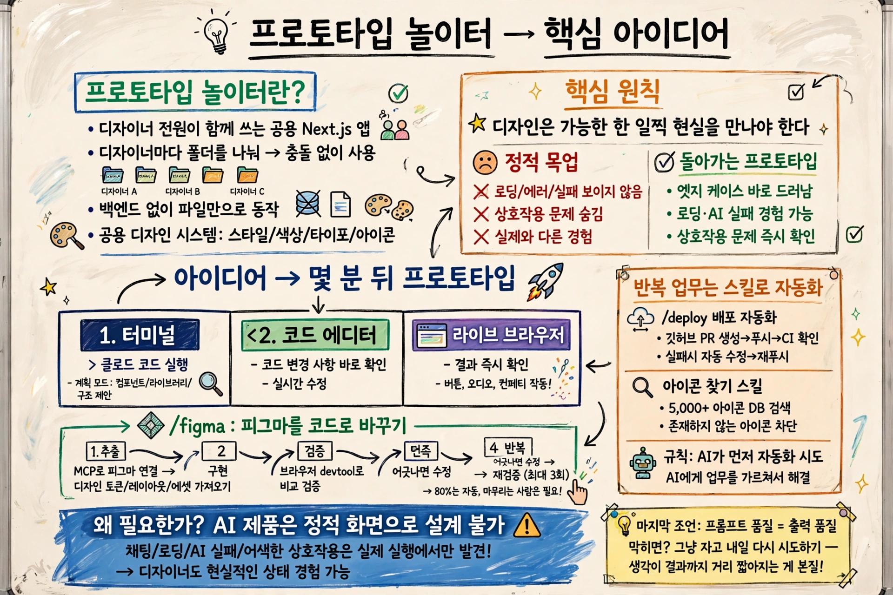
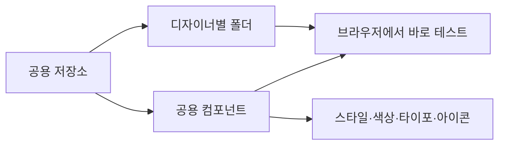
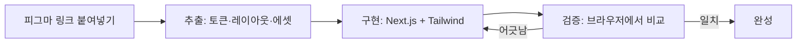
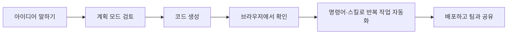

# 프론트엔드 코드를 3개월 동안 한 줄도 안 썼다고요? 프로토타입은 코드로 만듭니다

> **Summary**
> 노션 디자인 팀은 공용 Next.js 앱인 프로토타입 놀이터에서 클로드 코드로 프로토타입을 만듭니다. 정적 목업 대신 돌아가는 코드로 일찍 현실을 만나고, 음성 지시와 계획 모드로 아이디어를 몇 분 만에 화면으로 바꿉니다. 피그마 변환·아이콘 찾기·배포 같은 반복 작업은 명령어와 스킬로 자동화해, 디자이너가 코드 한 줄 안 쓰고도 프로토타입을 끝까지 완성합니다.

---

- 프로토타입 놀이터는 디자이너 전원이 함께 쓰는 공용 `Next.js` 앱입니다. 디자이너마다 폴더를 나눠 충돌 없이 쓰고, 브라우저에서 바로 테스트합니다.
- 핵심은 현실을 일찍 만나는 것입니다. 정적 목업이 감추는 엣지 케이스와 상호작용 문제를, 돌아가는 프로토타입은 바로 드러냅니다.
- 반복 작업은 명령어와 스킬로 가르칩니다. `/figma`로 피그마를 코드로 바꾸고, `/deploy`로 배포하고, 아이콘 찾기는 스킬에 맡깁니다.

## 피그마에서 예쁘게 나온 화면, 실제로 써보면 다르지 않으셨나요?

디자인 시안을 받으면 화면은 완벽해 보입니다. 그런데 막상 만들어보면 버튼을 눌렀을 때 로딩이 길고, AI 답변이 이상하게 나오고, 화면이 예상과 다르게 흘러갑니다. 정적 목업에서는 보이지 않던 문제들이 실제 화면에서만 드러나죠. 이 간극을 줄이는 방법이 있습니다. 목업을 만드는 대신, 처음부터 코드로 프로토타입을 만드는 것입니다!

🎥 [동영상 보기](https://www.youtube.com/watch?v=s4HGbIhUgVo)

## 프로토타입 놀이터가 뭔가요?

프로토타입 놀이터는 디자인 팀 전원이 함께 쓰는 공용 `Next.js` 앱입니다. 거창한 플랫폼이 아닙니다. 하나의 저장소에 팀 전체가 들어갑니다. 디자이너마다 폴더를 나눠서 각자 작업이 부딪히지 않고, 백엔드 데이터베이스 없이 파일만으로 돌아갑니다. 디자인 시스템의 스타일·색상·타이포그래피·아이콘이 공용 컴포넌트로 들어 있어서, 새 프로토타입은 일관된 모습으로 시작합니다. 피그마나 다른 도구의 프로토타입도 한곳에서 찾을 수 있게 링크를 모아둡니다.

핵심 원칙은 하나입니다. 디자인은 가능한 한 일찍 현실을 만나야 합니다. 돌아가는 프로토타입은 제약을 드러내고, 엣지 케이스를 보여주고, 상호작용의 문제를 바로 알려줍니다. 정적 목업은 이런 것들을 감춥니다!

## 아이디어를 말하면, 몇 분 뒤 프로토타입이 됩니다

작업 화면은 세 칸으로 나뉩니다. 한쪽은 클로드 코드를 돌리는 터미널, 가운데는 코드 에디터, 다른 한쪽은 라이브 브라우저 미리보기입니다. 프롬프트를 쓰고, 코드 변경을 확인하고, 결과를 바로 봅니다. 화면을 왔다 갔다 할 필요가 없습니다.

지시는 말로 합니다. 음성 입력 도구가 컴퓨터에 말하는 대로 받아적습니다. 긴 명세를 타이핑하는 것보다 훨씬 빠릅니다. 그리고 바로 코드를 짜지 않습니다. 먼저 계획 모드에서 클로드가 제안한 컴포넌트·라이브러리·구조를 읽어봅니다. 의심스러운 가정이 있으면 코드가 되기 전에 잡힙니다.

데모로 만든 것은 팟캐스트 에피소드 상세 페이지였습니다. 영상 플레이어와 오디오 플레이어, 제목과 설명이 있고, 재생을 누르면 플레이어에서 컨페티가 터지는 페이지입니다. 지시를 승인하자 클로드가 컨페티 라이브러리를 설치하고, `Tailwind CSS`로 페이지를 구성하고, 리액트 컴포넌트를 만들었습니다. 몇 분 뒤 오디오·영상·컨페티가 모두 돌아가는 프로토타입이 완성됐습니다!

## 피그마를 코드로 바꾸면, 검증까지 자동으로 돕니다

피그마 프레임을 코드로 바꾸는 명령어도 따로 만들었습니다. 터미널에 `/figma`를 치고 공개 피그마 프레임 링크를 붙여넣으면 됩니다. 과정은 네 단계입니다.

1. 추출: `MCP`로 피그마에 연결해 디자인 토큰·레이아웃·에셋을 가져옵니다.
1. 구현: `Next.js`와 `Tailwind CSS`로 화면 코드를 씁니다.
1. 검증: 브라우저 개발자 도구 `MCP` 서버로 만든 프로토타입을 열고, 피그마 프레임과 비교합니다.
1. 반복: 어긋난 부분이 있으면 코드를 고치고 다시 검증합니다. 맞을 때까지, 또는 세 번 연속 변화가 없을 때까지 돕니다.
데모에서는 피그마 링크에서 노션 스타일 사이드바를 만들었습니다. 첫 결과물은 이미지가 깨져 있었는데, 검증 루프가 경로를 고치고 다시 확인했습니다. 한 번의 지시로 80%까지 간다는 게 이 팀의 평가입니다. 마무리는 여전히 사람의 손이 필요합니다!

## 반복되는 일은 AI에게 가르치면 됩니다

이 팀의 가장 중요한 규칙이 있습니다. AI가 뭔가를 해달라고 하면, 대답하기 전에 AI 스스로 그 일을 하게 가르칠 수 있는지 먼저 봅니다. 이 규칙에서 명령어와 스킬이 나왔습니다.

아이콘 찾기 스킬이 대표적입니다. AI가 존재하지 않는 아이콘 이름을 지어내면 가져오기가 깨집니다. 그래서 스킬에 지침과 함께 5,000개가 넘는 아이콘을 동의어까지 뒤지는 스크립트를 붙였습니다. 이름을 고르기 전에 실제 목록에서 찾으니까, 깨지는 가져오기가 사라졌습니다.

배포도 명령어 하나가 처리합니다. `/deploy`를 치면 깃허브 CLI가 있는지 확인하고, 브랜치를 만들고, 파일을 모으고, 커밋하고, 푸시하고, 풀 리퀘스트를 열고, 브라우저로 띄웁니다. 그리고 30~60초마다 CI 상태를 확인합니다. 검사나 타입 확인이 실패하면 고치고 다시 푸시해서 통과할 때까지 돕니다. 프로토타입 저장소라서 CI만 통과하면 바로 합치는 게 보통입니다.

## AI 제품은 정적 화면으로 설계할 수 있을까요?

채팅 화면의 동작이나 언어 모델의 실패 양상은 정적 목업으로 재현할 수 없습니다. 돌아가는 프로토타입은 로딩 상태, AI 실패, 어색한 상호작용, 틀린 가정을 일찍 보여줍니다. 디자이너가 도구의 모든 부분을 마스터하지 않아도, 현실적인 상태를 직접 경험할 수 있습니다.

마지막 조언도 기억에 남습니다. 출력의 품질은 입력의 품질과 직결됩니다. 프롬프트가 잘 안 써질 때는, 그냥 자고 내일 다시 시도하는 게 낫다고요. 생각이 결과물까지 가는 거리가 짧아진 게, 이 방식의 본질입니다!

