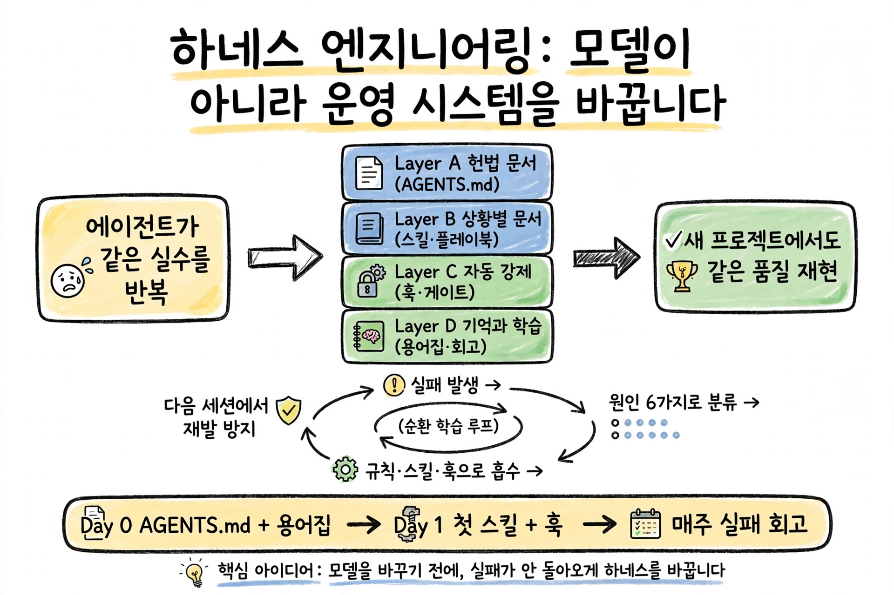
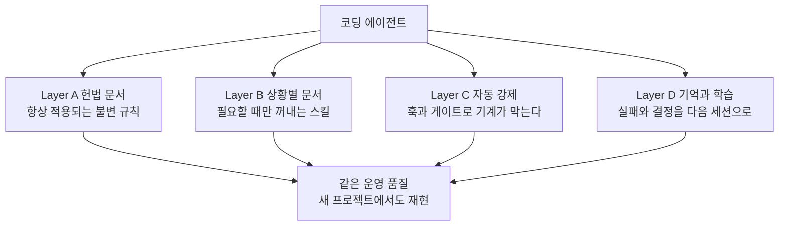
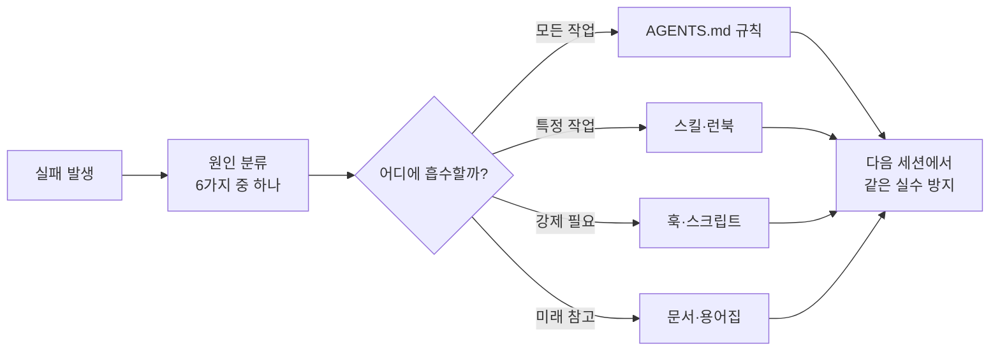
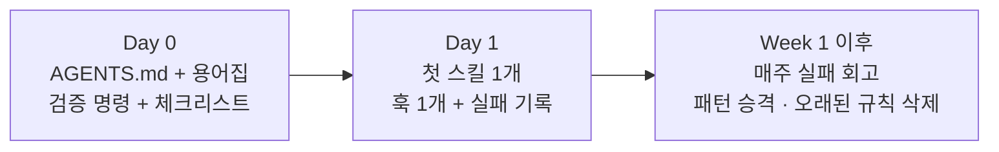

# 하네스 엔지니어링: 모델을 바꾸기 전에, 실패가 안 돌아오게 하네스를 바꿉니다

> **Summary**
> 하네스 엔지니어링은 모델 자체를 바꾸기보다 규칙, 상황별 절차, 자동 검증, 실패 기록을 체계화해 에이전트의 반복 실수를 막고 새 프로젝트에서도 일관된 운영 품질을 재현하는 방법입니다. 실패 원인에 따라 규칙·스킬·훅·문서에 개선을 반영하고, 불필요하거나 중복된 규칙은 주기적으로 정리합니다.

---

- 하네스는 모델이 아니라 모델 바깥에서 동작을 제어하는 운영 레이어입니다.
- 핵심은 하나입니다. 모델을 바꾸기 전에, 실패가 다시 발생하지 않도록 하네스를 바꿉니다.
- 네 개 레이어로 나누고 실패를 규칙·스킬·훅으로 흡수하면, 새 프로젝트에서도 같은 운영 품질이 재현됩니다.

코딩 에이전트한테 같은 지시를 세 번째 반복한 적 있으시죠? 테스트를 빼먹지 말라고 했는데 또 빼먹고, 문서를 고치라고 했는데 또 안 고치고요. 모델이 나빠진 게 아닙니다. 매번 말로만 고치니까요!

🎥 [동영상 보기](https://www.youtube.com/watch?v=am_oeAoUhew)

## 하네스, 도대체 뭘까요?

하네스는 모델 자체가 아닙니다. 모델 바깥에서 에이전트의 동작을 제어하는 운영 레이어입니다. 시스템 지침, 상황별 지식, 도구 연결, 분리 실행, 자동 검증, 기억과 피드백까지 여섯 가지 요소가 들어갑니다.

쉽게 말하면, 에이전트에게 "잘해줘"라고 말하는 대신 일하는 판을 짜주는 일입니다. 규칙은 `AGENTS.md`나 `CLAUDE.md` 같은 문서에, 절차는 스킬과 플레이북에, 검증은 훅과 체크리스트에 나눠 담습니다.

핵심 원칙은 한 줄입니다. 모델을 바꾸기 전에, 실패가 다시 발생하지 않도록 하네스를 바꿉니다!

## 왜 네 개 레이어로 나눌까요?

모든 규칙을 한 파일에 밀어 넣으면 어떻게 될까요? 파일은 길어지고, 에이전트는 규칙끼리 충돌시키며 헤맵니다. 그래서 하네스는 네 개 레이어로 나눕니다.

**Layer A: 헌법 문서** — 모든 작업에 항상 적용되는 불변 규칙이 들어갑니다. 문서 우선 원칙, 검증 필수 원칙, 파괴적 명령 금지 같은 것들입니다. 짧게 유지하는 게 생명입니다!

**Layer B: 상황별 실행 문서** — 특정 작업에서만 필요한 규칙입니다. 마이그레이션 스킬, 코드 리뷰 플레이북, 장애 복구 런북처럼 필요할 때만 꺼내 씁니다.

**Layer C: 자동 강제 장치** — 사람이 잊거나 모델이 건너뛰기 쉬운 항목을 기계로 막습니다. 커밋 전 린트, 푸시 전 테스트, 완료 게이트가 여기에 속합니다. 사람 의지보다 자동화가 강합니다!

**Layer D: 기억과 학습 문서** — 실패와 결정, 운영 사실을 다음 세션을 위해 남깁니다. 용어집, 결정 기록, 장애 회고, 반복 실패 목록이 여기에 들어갑니다.

좋은 하네스의 조건은 다섯 가지입니다. 짧고, 분리돼 있고, 강제력이 있고, 누적되고, 이식 가능합니다.

## 실패는 어떻게 흡수할까요?

에이전트가 실수했을 때, 고치는 것보다 중요한 일이 있습니다. 그 실수가 다시 안 나오게 시스템에 박아두는 일입니다. 실패를 수동 수정으로 끝내면, 다음 세션에서 똑같은 실수가 돌아옵니다.

순서는 이렇습니다. 먼저 실패를 여섯 가지 원인 중 하나로 분류합니다. 전역 규칙 부재, 절차 부재, 자동화 부재, 용어·문서 불일치, 컨텍스트 오염, 권한 경계 불명확이 그 여섯 가지입니다.

다음으로 흡수할 위치를 정합니다. 모든 작업에 해당하면 `AGENTS.md`에, 특정 작업에만 해당하면 스킬로, 반복 위반을 강제로 막아야 하면 훅으로, 미래 참고가 중요하면 문서로 옮깁니다. 같은 누락이 두 번만 나와도 훅 후보로 올립니다. 검증 없이 "완료"라고 보고하는 건, 하네스가 막아야 할 첫 번째 함정입니다.

## 새 프로젝트, 어디서부터 시작할까요?

하네스는 처음부터 거창하게 만들 필요가 없습니다. 여섯 개만 있으면 기본 동작이 됩니다.

Day 0에는 루트 `AGENTS.md`를 쓰고, `docs/` 아래 운영 문서 폴더와 용어집을 만들고, 검증 명령 하나와 완료 체크리스트 하나를 정합니다. Day 1에는 반복 작업 하나를 스킬로 분리하고, 훅 하나와 실패 기록 문서를 추가합니다. 그다음부터는 매주 한 번 실패를 회고하고, 반복되는 패턴을 규칙·스킬·훅으로 승격할지 정합니다.

## 서브에이전트는 언제 쓸까요?

서브에이전트는 역할놀이가 아닙니다. 컨텍스트 방화벽입니다. 큰 검색 결과가 메인 스레드를 오염시킬 때, 독립적인 조사나 검증이 필요할 때, 구현과 검증을 병렬로 돌릴 때 씁니다.

반대로 지금 당장 결과가 필요한 핵심 작업이나 아주 작은 수정에는 쓰지 않습니다. 읽지 않고 떠넘기는 탐색도 금물입니다. 그리고 같은 실수 패턴이 반복되면, 서브에이전트를 늘리기 전에 하네스 개선을 먼저 봅니다.

유지보수도 빼놓을 수 없습니다. 하네스는 커질수록 성능이 떨어집니다. 8주 이상 한 번도 필요 없던 규칙, 중복 규칙, 임시 규칙은 주기적으로 삭제하거나 축약합니다. 전역 문서가 지나치게 길어지거나 같은 규칙이 여러 문서에 복제돼 있으면, 이미 비대해졌다는 신호입니다.

## 좋은 하네스는 문장 모음이 아닙니다

좋은 하네스는 "에이전트가 잘하길 기대하는 문장 모음"이 아닙니다. 실패를 규칙, 문서, 스킬, 훅으로 누적 흡수하는 운영 시스템입니다. 모델은 계속 바뀝니다. 남는 건 실패를 규칙으로 쌓아 올린 운영 시스템입니다!

