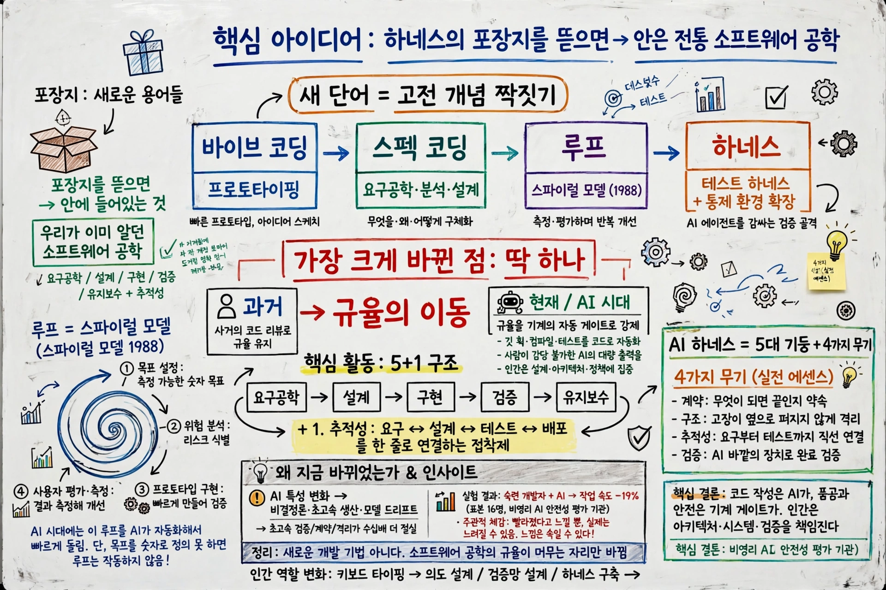
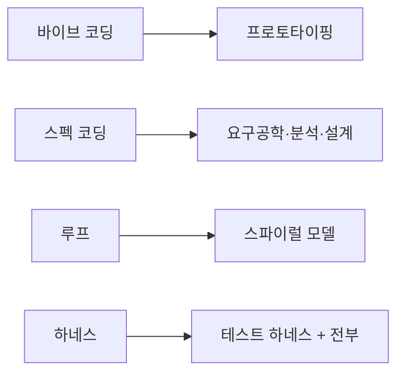
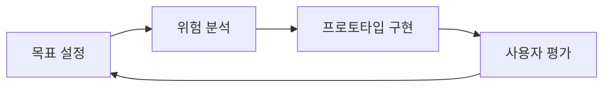
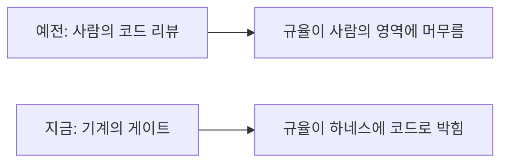

# 하네스의 알맹이는 결국 소프트웨어 공학입니다. 바뀐 건 규율이 사는 자리뿐입니다

> **Summary**
> 하네스라는 새 단어의 포장지를 뜯으면, 안에는 우리가 이미 알던 소프트웨어 공학이 들어 있습니다. 바이브 코딩은 프로토타이핑, 스펙 코딩은 요구공학, 루프는 스파이럴 모델, 하네스는 테스트 하네스의 확장입니다. 새로 바뀐 것은 하나뿐입니다. 규율이 사람의 리뷰에서 기계의 게이트로 자리를 옮겼습니다.

---

- 하네스의 포장지를 뜯으면, 안에는 우리가 이미 알던 소프트웨어 공학이 들어 있습니다.
- 바이브 코딩은 프로토타이핑, 스펙 코딩은 요구공학, 루프는 스파이럴 모델, 하네스는 테스트 하네스의 확장입니다.
- 새로 바뀐 것은 하나뿐입니다. 규율이 사람의 리뷰에서 기계의 게이트로 자리를 옮겼습니다.

AI에게 코드를 맡기고 나서, 이런 생각이 드신 적 있으시죠? "이거, 내가 예전에 하던 일과 뭐가 다르지?"

새 단어가 쏟아집니다. 바이브 코딩, 스펙 코딩, 루프, 하네스. 그런데 포장지를 뜯어보니 알맹이는 우리가 이미 알던 소프트웨어 공학 그대로였습니다.

🎥 [동영상 보기](https://www.youtube.com/watch?v=wc8FBhQtdsA)

### 한 문장이 포장을 뜯었습니다

유명한 웹 프레임워크의 공동 창시자가 남긴 한 문장이 있습니다.

> 제대로 코드 리뷰를 하고, 테스트를 촘촘히 돌리고, 남에게 아키텍처를 설명할 수 있다면 그건 '바이브 코딩'이 아니라 그냥 소프트웨어 개발이다.

국제 표준 기구의 정의는 "체계적이고 규율적이며 정량적인 접근을, 소프트웨어의 개발과 운영과 유지보수에 적용하는 것"입니다. 쉽게 풀면, 감으로 코딩하지 말고 기획부터 배포까지 예측 가능하고 재현할 수 있는 공정 시스템을 만드는 일입니다.

핵심 활동은 요구공학, 설계, 구현, 검증, 유지보수 다섯 가지에 추적성이라는 접착제 하나를 더한 구조입니다.

소프트웨어 공학은 코드 한 줄 잘 짜는 스킬이 아닙니다. **코딩을 감싸고 도는 전체 프로세스의 규율과 시스템 구조**가 바로 소프트웨어 공학입니다. AI가 코딩을 대신해 주는 시대일수록, 그 둘레의 규율은 오히려 더 중요해집니다.

### 요즘 말, 고전으로 번역해 보면?

요즘 쏟아지는 신조어들을 고전과 짝지어 보면, 그림이 선명해집니다.

| 요즘 말 | 떠올리면 되는 고전 | 한 줄 요약 |
| --- | --- | --- |
| 바이브 코딩 | 프로토타이핑 | 느낌대로 빠르게 만들어 보는 1회용 스케치 |
| 스펙 코딩 | 요구공학·분석·설계 | 무엇을, 왜 만드는지 텍스트로 먼저 못 박기 |
| 루프 | 스파이럴 모델 | 목표 설정 → 측정 → 실행 → 교정의 무한 반복 |
| 하네스 | 테스트 하네스 + 그 위의 전부 | 모든 규칙을 기계적으로 강제하는 그릇 |

바이브 코딩은 프로토타이핑과 본질이 같습니다. 진짜 사고는 그 스케치를 프로덕션이라고 우길 때 터집니다.

### 루프와 하네스, 왜 지금 다시 뜰까요?

루프부터 보겠습니다. 측정 가능한 목표를 세워두고, 시스템이 스스로 측정하고 검증하면서 더 나은 출력을 내도록 뱅글뱅글 돌리는 방식입니다.

이것도 새 혁신이 아닙니다. 1988년에 정립된 스파이럴 모델이 정확히 이 그림입니다. 목표 설정 → 위험 분석 → 프로토타입 구현 → 사용자 평가를 거쳐 다음 나선으로 넘어가는 반복 주기죠. 한 바퀴 돌 때마다 완성을 향해 한 칸씩 안으로 파고듭니다.

AI 시대에 달라진 점은 하나, 사람이 수동으로 하던 측정과 개선 루프를 AI가 자동화해서 돌릴 수 있게 된 것입니다. 다만 무서운 전제가 붙습니다. **목표를 명확한 숫자로 측정할 수 없으면, 루프는 한 바퀴도 돌지 못합니다.**

하네스도 마찬가지입니다. 테스트 하네스라는 용어는 소프트웨어 공학에 오래전부터 있었습니다. 코드 한 조각을 떼어내 가짜 입력과 가짜 종속 모듈을 꼽고, 통제된 환경에서 굴려보며 검사하는 골격입니다. 지금의 AI 하네스는 통제의 대상이 AI 에이전트 그 자체로 커졌을 뿐, 철학은 똑같습니다.

### 규율이 사는 자리가 바뀌었습니다

그런데 하네스는 단일 툴이 아닙니다. 5대 기둥부터 네 가지 무기, 자동 배포 파이프라인과 모니터링까지. 이 모든 규율을 한곳에 담아 강제하는 그릇입니다.

AI 개발로 넘어오며 가장 근본적으로 바뀐 지점이 드러납니다. 예전에는 이 규율들을 기계로 강제할 필요가 없었습니다. 대부분 코드 리뷰라는 사람의 눈에 의존해서 걸러냈으니까요.

그런데 AI는 사람이 상상도 못 할 속도로 코드를 무더기로 쏟아냅니다. 눈으로 읽으며 검토하는 방식으로는 이 생산성을 감당할 수 없습니다. 게다가 AI는 틀린 답도 자신 있게 내놓습니다.

그래서 옛날 방식은 파산했습니다. 사람이 판단하던 규율과 검증 로직 자체를 코드로 짜서 기계적인 게이트로 구체화해야 합니다. 깃 훅이 위험한 명령을 원천 차단하고, 컴파일 오류나 타입 미스를 기계가 즉시 감지해 실패 표시를 세웁니다. 사람의 코드 리뷰가 사라진다는 뜻이 아닙니다. **지루하고 반복되는 검증은 시스템에 맡기고, 사람은 시스템 설계와 아키텍처 판단에 집중**하도록 무게중심이 이동한 것입니다.

정리하면, 완전히 새로운 개발 기법이 튀어나온 게 아닙니다. **소프트웨어 공학의 규율이 머무는 자리가 달라졌을 뿐**입니다.

### 그런데 현장의 숫자는 따끔합니다

이상과 달리 현실은 쉽지 않습니다. AI로 빠르게 코드를 찍어내면 검증 부담도 함께 늘어납니다. 테스트나 품질 검증을 생략하거나, AI의 "이 코드 완벽합니다!"라는 말만 믿고 메인 브랜치에 밀어 넣는 경우도 적지 않습니다.

가슴 서늘한 실증 데이터가 하나 있습니다. 비영리 AI 안전성 평가 기관의 실험에서, 숙련된 오픈소스 개발자들이 AI 도구를 쥐었더니 작업 속도가 오히려 **19%나 더 느려졌습니다.** 그런데 참가한 개발자 본인들은 'AI 덕분에 코딩이 엄청 빨라졌는데?'라며 생산성이 올라갔다고 믿었다고 합니다.

이 실험의 무서운 통찰은 19%라는 숫자 자체가 아닙니다. **아무리 베테랑이라도 AI를 주먹구구식으로 부리면 작업이 느려진다는 것, 그리고 그 사실을 본인조차 눈치채지 못했다는 점**입니다. 주관적인 속도 체감만큼 믿을 수 없는 필터가 없습니다!

단, 이 실험의 표본은 16명으로 아주 작습니다. "느낌은 속일 수 있다"는 경고로 읽는 게 맞습니다.

### 네 가지 무기, 그리고 왜 하필 지금인가

소프트웨어 공학은 기획부터 배포, 테스트, 형상관리까지 아우르는 방대한 학문입니다. 이 책에서는 AI가 자신 있게 틀리는 시대에 실제 제품을 굴리며 가장 효과가 컸던 무기 넷을 골랐습니다.

| 무기 | 무엇인가 | 어떤 고통을 푸나 |
| --- | --- | --- |
| 계약 | 무엇이 되면 "끝"인지 먼저 약속으로 박기 | 자신 있게 틀림 |
| 구조 | 한 칸씩 나눠 짓고 고장이 옆으로 안 번지게 격리 | 조용한 오염, 옆 칸 깨짐 |
| 추적성 | 요구부터 테스트까지 한 줄로 잇기 | 무엇을 만들지 잃어버림 |
| 검증 | 끝났다는 말을 AI 바깥의 장치로 확인 | 가짜 성공 |

정직하게 짚고 갈 점이 있습니다. 이 네 가지 분류는 전공 서적의 표준 분류가 아닙니다. AI 에이전트 코딩의 거친 파도 속에서 직접 굴려보니 가장 효과가 컸던 네 가지를 우려낸 실전 에센스입니다.

왜 하필 지금일까요? 업계는 오래전부터 '완벽하게 설계해서 한 방에 만드는 것'보다 '일단 시장에 던져놓고 피드백을 받아 쪼개 가며 바꾸는 것'이 생존에 유리하다는 진리를 체득해 왔습니다. AI 에이전트 개발은 그 흐름의 최종 진화형처럼 보입니다.

여기에 AI의 독특한 성질이 하나 더 섞입니다. **똑같은 질문에도 출력이 매번 미세하게 달라지는 비결정론적 특성, 그리고 기반 모델이 매달 업데이트되어 지능 균형이 흔들리는 드리프트 현상**입니다. 그래서 계약, 초고속 검증, 갈아 끼울 수 있는 구조가 예전보다 수십 배는 더 절실해졌습니다.

정리하겠습니다. 소프트웨어 공학 무대에 새로운 액터, AI 에이전트가 정식 멤버로 합류했습니다. 코딩을 도와주는 편리한 툴 정도로 얕잡아 봐서는 안 됩니다. 철저하게 통제하고 프로세스에 묶어두어야 하는 관리 대상이자, 파이프라인 혁신을 이끌 파트너입니다.

인간 개발자가 독점해 오던 코드 작성과 빌드, 일차적 검증을 AI가 나누어 짊어지기 시작했습니다. 그러므로 인간의 주 업무는 키보드를 두드리는 타이핑에서, **소프트웨어의 올바른 의도를 정밀하게 설계하고, 그 의도가 훼손되지 않도록 검증망을 설계하며, 전체 아키텍처의 견고한 골격(하네스)을 짓는 자리**로 올라서게 됩니다. 하네스의 진짜 알맹이는 결국 소프트웨어 공학의 기본기입니다. 바뀐 것은 코드를 짜는 노동을 AI가 가져간 것뿐입니다.

