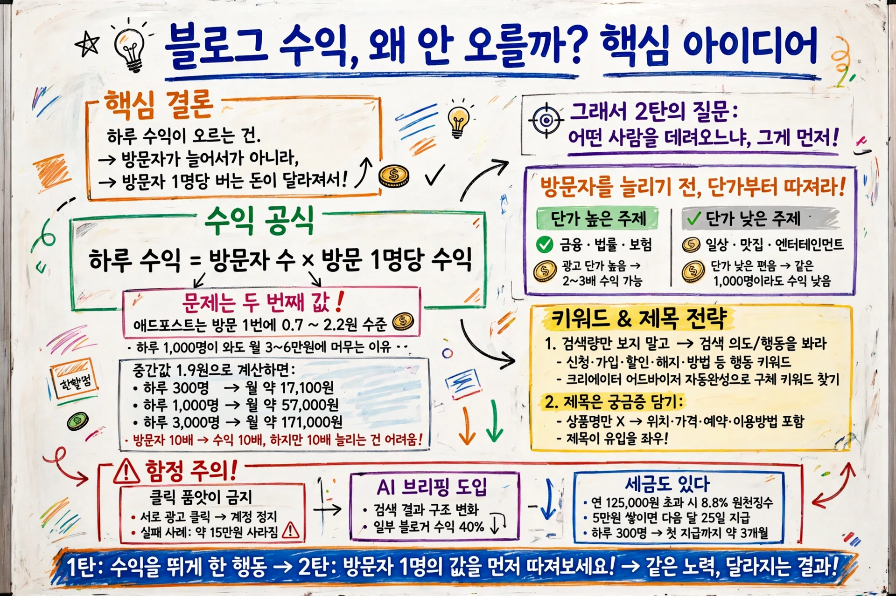
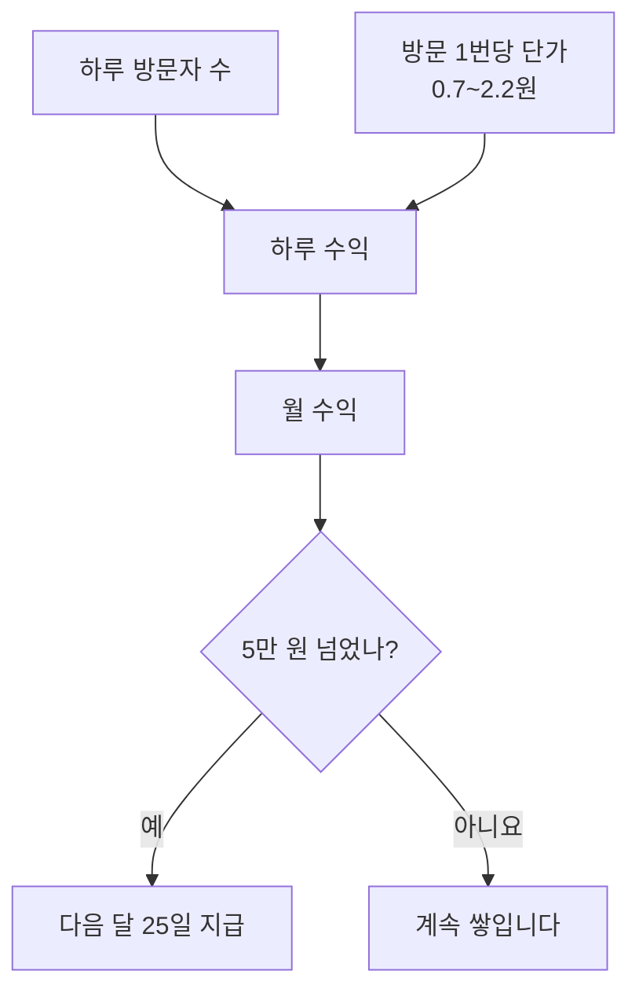
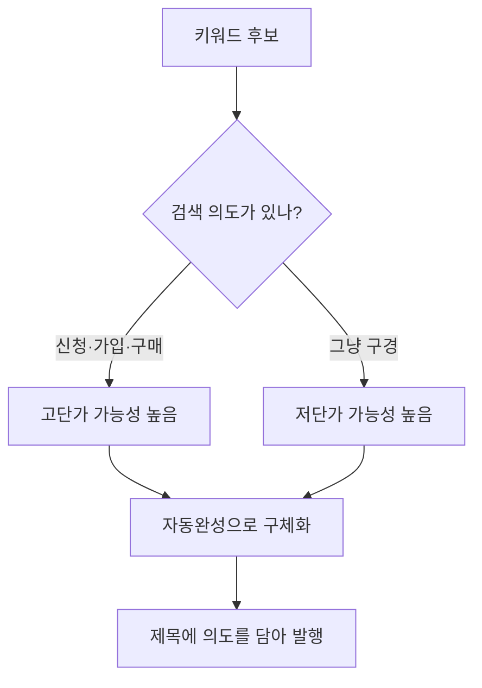

# 하루 1만 원이 7만 원이 된다고요? 방문자 수가 아니라 방문자 1명의 값입니다

> **Summary**
> 애드포스트 수익은 방문자 수뿐 아니라 방문자 1명당 단가에 좌우되므로, 검색량보다 신청·가입·구매처럼 행동 의도가 뚜렷한 키워드를 선택하고 제목에 구체적인 궁금증을 담는 것이 중요합니다. 수익은 보장되지 않으며, 광고 클릭 품앗이는 계정 정지 위험이 있고 검색 환경 변화와 세금·지급 기준도 고려해야 합니다.

---

- 하루 수익이 오르는 건 방문자가 늘어서가 아니라, 방문자 1명당 버는 돈이 달라져서입니다.
- 공개된 후기를 보면 애드포스트는 방문 1번에 0.7~2.2원 수준이라, 하루 1,000명이 와도 월 3~6만 원에 머뭅니다.
- 그래서 2탄의 질문은 하나입니다. 어떤 사람을 데려오느냐, 그게 먼저입니다.

블로그에 글을 올렸는데, 하루 수익이 몇 백 원에서 안 움직인 적 있으시죠? 글은 매일 쓰는데 통장은 조용합니다. 1탄에서 하루 1만 원이 7만 원으로 올랐다는 이야기가 나왔습니다. 그런데 그 숫자를 그대로 믿고 따라 하면 안 됩니다!

먼저 밝히겠습니다. 원문 포스트는 직접 읽지 못했습니다. 이 글은 시리즈 제목과 공개된 애드포스트 수익 구조를 바탕으로 재구성했습니다. 하루 1만 원에서 7만 원이라는 수치도 원문 작성자의 주장일 뿐, 보장된 수익이 아닙니다.

🎥 [동영상 보기](https://www.youtube.com/watch?v=3gYO9amf2IQ)

## 수익 공식, 먼저 봅시다

하루 수익은 간단한 곱셈입니다. 방문자 수에 방문 1번당 버는 돈을 곱하면 됩니다. 문제는 두 번째 숫자입니다. 공개된 후기를 보면 애드포스트는 방문 1번에 0.7~2.2원 수준입니다. 하루 1,000명이 와도 월 3~6만 원에 머무는 이유가 여기 있습니다!

중간값 1.9원으로 계산해 보겠습니다. 하루 300명이면 월 약 17,100원입니다. 하루 1,000명이면 월 약 57,000원입니다. 하루 3,000명이면 월 약 171,000원입니다. 방문자가 10배가 돼야 월 수익이 10배가 됩니다. 그런데 방문자를 10배로 늘리는 일이 쉬울까요?

## 방문자를 늘리기 전에, 단가부터 따져야 하지 않을까요?

같은 1,000명이라도 버는 돈이 2~3배 차이 날 수 있습니다. 주제 때문입니다. 금융·법률·보험처럼 상업성이 높은 주제는 광고 단가가 높습니다. 일상·맛집·엔터테인먼트 계열은 단가가 낮은 편입니다. 글은 같은 분량으로 쓰는데, 데려온 사람의 값이 다른 겁니다!

그래서 키워드를 고를 때 봐야 할 것은 검색량만이 아닙니다. 검색하는 사람이 무엇을 하려는지가 먼저입니다. 신청·가입·할인·해지·방법처럼 행동이 드러나는 검색어가 단가가 높은 쪽에 가깝습니다. 크리에이터 어드바이저의 자동완성을 살펴보면, 경쟁이 큰 대표 키워드 대신 구체적인 검색어를 찾을 수 있습니다.

제목도 같은 원리로 씁니다. 상품이나 인물 이름만 적는 대신, 위치·가격·예약·이용 방법처럼 검색자의 궁금증을 함께 담는 편이 낫습니다. 제목은 글의 문장력만큼, 어쩌면 그보다 더 중요하게 유입을 좌우합니다. AI가 본문 초안을 만들어도, 어떤 주제와 제목을 고를지는 작성자의 몫으로 남습니다!

## 함정도 있습니다. 조심해야 합니다!

빨리 올리고 싶다고 서로 광고를 눌러 주는 모임에 들어가면 어떻게 될까요? 정지입니다. 공개된 실패 사례에서는 쌓인 약 15만 원이 사라졌다고 합니다. 클릭 품앗이는 지름길이 아니라 출구입니다!

검색 환경도 바뀌고 있습니다. AI 브리핑이 도입되면서 검색 결과 구조가 달라졌고, 일부 블로거는 수익이 40% 가까이 줄었다고 밝히기도 했습니다. 어제 통하던 방식이 내일도 통한다는 보장은 없습니다.

세금도 있습니다. 연 125,000원을 넘으면 8.8%를 원천징수합니다. 5만 원이 쌓여야 다음 달 25일에 지급됩니다. 하루 300명 수준이면 첫 지급까지 약 3개월이 걸립니다. 느리다고요? 그래서 더더욱 단가부터 따져야 합니다!

1탄이 수익을 뛰게 한 행동 이야기였다면, 2탄은 그 다음 질문입니다. 방문자를 세기 전에, 방문자 1명의 값을 먼저 따져보세요. 숫자가 바뀌면 같은 노력의 결과가 달라집니다!

