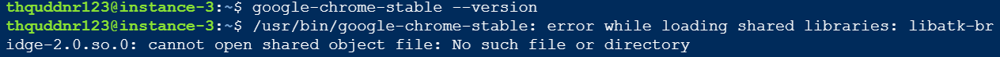
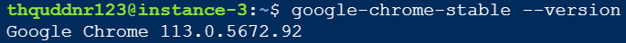
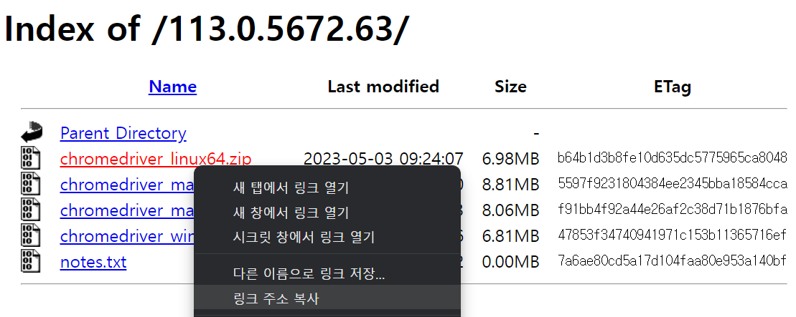
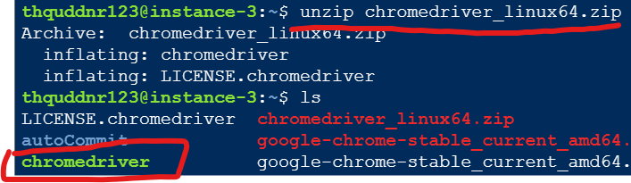
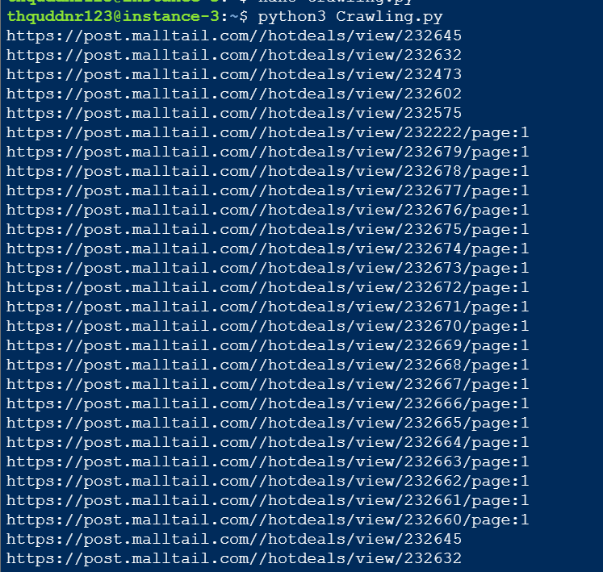
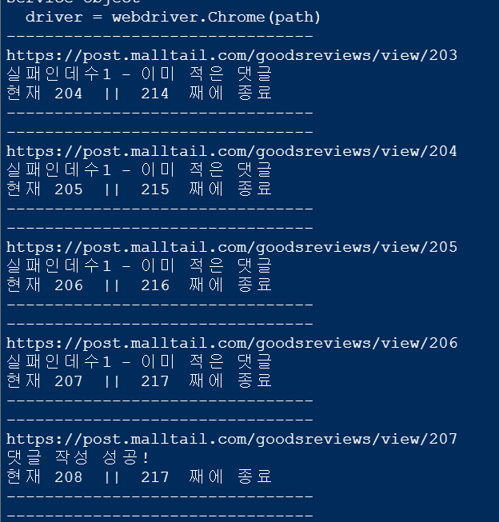

# 하루 20달러 파밍 1

> **Summary**
> 셀레니움을 서버에 설치하고, 구글 클라우드 서비스를 활용하여 다수의 계정을 동시에 가동하여 효율성을 극대화하는 방법을 설명합니다. Ubuntu에 크롬과 웹드라이버를 설치하고, 필요한 라이브러리를 설치한 후, 셀레니움을 사용하여 웹 크롤링 코드를 작성하고 실행하는 과정이 포함되어 있습니다.

---


> 💡 ****배송비를 50% 이상 절감시켜봅시다****
>
> 기존 매크로는 하루에 1000캐시밖에 들어오지 않는다
>
> 이는 0.1 달러 대충 하루에 120~130원 주는 꼴이다
>
> 모니터 전기비용이 더 많이나올거같으니 무료 서버를 활용하여 계정 n개를 동시에 가동시켜 효용을 극대화 하고자 한다
>
>

구글 클라우드 서비스 (GCP) 를 사용할건데, 내가 이전에 작성한 글을 참고하면 좋다

[github 커밋 자동화 프로그램](https://app.notion.com/p/de7dbe887e274d6493b646269b476e7d) 

🔗 [https://cybecho.notion.site/github-de7dbe887e274d6493b646269b476e7d](https://cybecho.notion.site/github-de7dbe887e274d6493b646269b476e7d)

# Ubuntu에 크롬 설치

> → 0.공개키 발급

```shell
sudo apt-key adv --keyserver keyserver.ubuntu.com --recv-keys 4EB27DB2A3B88B8B
```

> → 1.시스템 패키지 목록 업데이트

```shell
sudo apt update
```

> → 2.종속성 설치

```shell
sudo apt install -y libxss1 libappindicator1 libindicator7
```

> → 3.크롬설치 패키지 다운로드

```shell
wget https://dl.google.com/linux/direct/google-chrome-stable_current_amd64.deb
```

> → 4.크롬 설치

```shell
sudo dpkg -i google-chrome-stable_current_amd64.deb
```

> 💡 **종속성 설치 중 에러가 발생되었을땐? **
> ```fortran
> sudo apt --fix-broken install
> ```
>
> →(예를들어 크롬 버전을 확인하려는데 확인이 안될때 사용..
>
> 
>
>

> → 5.크롬 시작



```shell
google-chrome-stable --version
```

```shell
sudo dpkg -i google-chrome-stable_current_amd64.deb
```


# Webdriver 설치

🔗 [https://sites.google.com/chromium.org/driver/?pli=1](https://sites.google.com/chromium.org/driver/?pli=1)




> → 1. 크롬 드라이버 다운로드

```shell
wget -N https://chromedriver.storage.googleapis.com/113.0.5672.63/chromedriver_linux64.zip
```


> → 2.압축 해제

```shell
unzip chromedriver_linux64.zip
```



> 🚨 **만약 unzip 이 설치되어있지 않으면 압축해제 오류가 발생합니다. 
다운받은 zip파일을 압축 해제하기 전에
다음 명령어를 입력해 unzip을 설치하도록 합니다**
> ```fortran
> sudo apt install unzip
> ```
>
>


# selenium 및 관련 라이브러리 설치

```shell
**sudo pip install xlrd

sudo apt-get install xvfb

sudo pip install pyvirtualdisplay**

sudo pip install selenium

sudo pip install webdriver_manager

sudo pip install beautifulsoup4

sudo pip install openpyxl
```

`xlrd`는 Python에서 Excel 파일을 읽어들이기 위한 라이브러리입니다.

`xvfb`는 디스플레이가 없는 환경에서 GUI 애플리케이션을 실행할 때 유용합니다.

`pyvirtualdisplay`는 Xvfb를 사용하여 가상 디스플레이를 만들고, 이 가상 디스플레이에서 GUI 애플리케이션을 실행할 수 있도록 해주는 라이브러리입니다.


> GUI가 미제공되는 GCP Ubuntu 환경에서 pyvirtualdisplay는 가상의 디스플레이를 만든 후 셀레니움이나 pyautogui같은 디스플레이가 필요한 작업에서 코드가 정상 작동하도록 합니다


```shell
pip list
```


# 코드작성 및 실행

```shell
pwd
```

> 셀레니움 실행 테스트 1

```python
from selenium import webdriver
from pyvirtualdisplay import Display

display = Display(visible=0, size=(1920, 1080))
display.start()

path='/home/ubuntu/chromedriver'
driver = webdriver.Chrome(path)
```

> 셀레니움 실행 테스트 2

```python
from selenium import webdriver

user_agent = 'Mozilla/5.0 (X11; Linux x86_64) AppleWebKit/537.36 (KHTML, like Gecko) Chrome/60.0.3112.50 Safari/537.36'

options = webdriver.ChromeOptions()
options.add_argument('--headless')
options.add_argument('--no-sandbox')
options.add_argument('--disable-dev-shm-usage')
options.add_argument('user-agent={0}'.format(user_agent))
driver = webdriver.Chrome('./chromedriver',options=options)
# 아무런 경고가 없다면 이상없이 작동되는 것입니다

driver.get(url='https://naver.com')
# 페이지 이동

print(driver.current_url)
# 이동되었는지 확인

driver.close()
# 종료
```

> 크롤링 코드 테스트

```shell
from urllib.request import urlopen
from bs4 import BeautifulSoup
from openpyxl import Workbook
import os

urls = []
for page in range(1, 72):
    url = 'https://post.malltail.com/hotdeals/index/keyword:/page:' + str(page)
    html = urlopen(url)
    soup = BeautifulSoup(html, 'html.parser')
    for link in soup.find_all('a'):
        href = link.get('href')
        if '/hotdeals/view/' in href:
            urls.append("https://post.malltail.com/" + href)

wb = Workbook()
ws = wb.active
ws.title = 'URLs'
for i, url in enumerate(urls):
    ws.cell(row=i+1, column=1).value = url
    print(url)

filename = 'URLs.xlsx'
filepath = os.path.join(os.getcwd(), filename)
wb.save(filepath)
```






본격적인 코드작성 및 스케듈링은 다음 글에서 작성하겠다

# 참고 사이트

🔗 [https://somjang.tistory.com/entry/Ubuntu-Ubuntu-서버에-Selenium-설치하고-사용하기](https://somjang.tistory.com/entry/Ubuntu-Ubuntu-서버에-Selenium-설치하고-사용하기)

🔗 [https://velog.io/@jmon/우분투-서버에서-파이썬-셀레니움-사용하기-Ubuntu-Server-Python-Selenium-JMON?ssp=1&setlang=ko-KR&safesearch=off](https://velog.io/@jmon/우분투-서버에서-파이썬-셀레니움-사용하기-Ubuntu-Server-Python-Selenium-JMON?ssp=1&setlang=ko-KR&safesearch=off)

🔗 [https://oslinux.tistory.com/33](https://oslinux.tistory.com/33)

🔗 [https://ingus26.tistory.com/82](https://ingus26.tistory.com/82)

