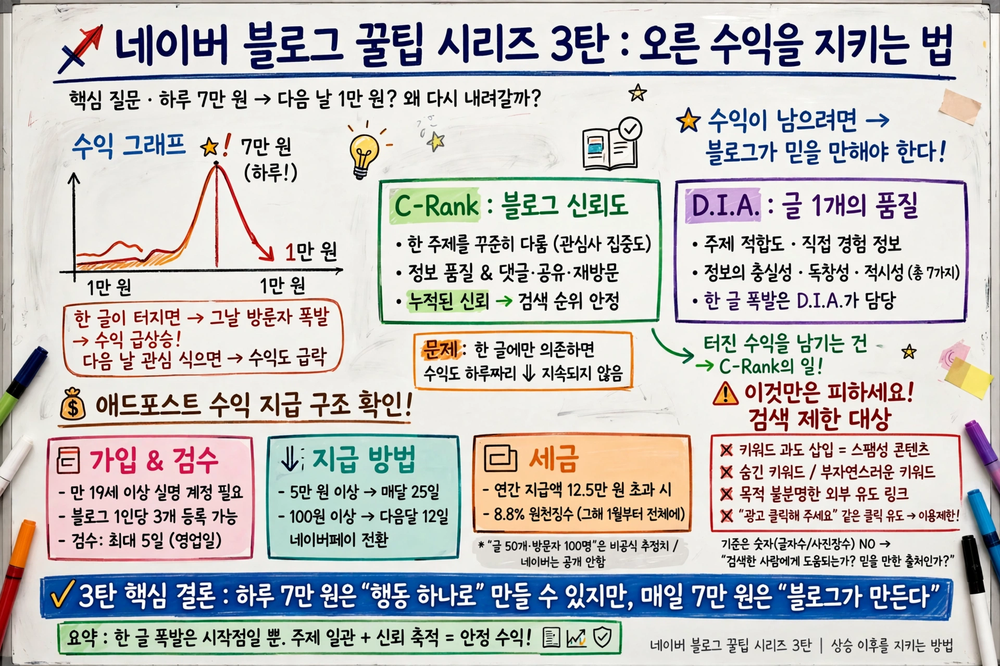
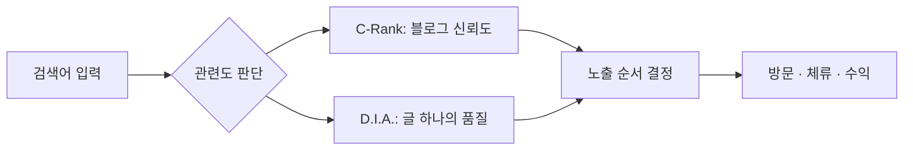
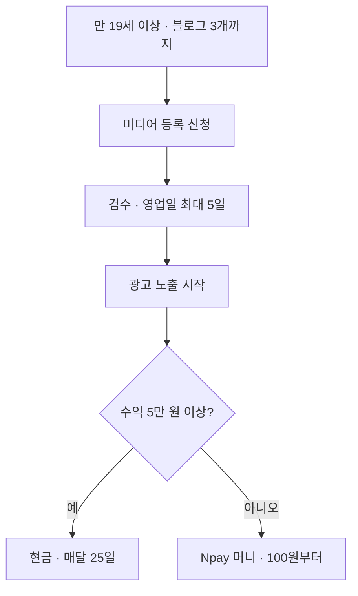

# 하루 7만 원 찍었다고 끝이 아닙니다. 다음 날도 7만 원인 블로그가 다릅니다

> **Summary**
> 하루 수익 급등은 한 글의 일시적 노출에 그칠 수 있으므로, 안정적인 수익을 위해서는 한 주제를 꾸준히 다루고 신뢰도와 글의 품질을 쌓아야 합니다. 애드포스트의 가입·지급 기준을 확인하고, 과도한 키워드 반복이나 클릭 유도 등 검색 제한을 부르는 행위는 피해야 합니다.

---

- 하루 수익이 1만 원에서 7만 원으로 뛰었습니다. 그런데 다음 날, 다시 1만 원으로 돌아왔습니다. 이럴 때가 있습니다!
- 그 행동 하나로 수익이 수직상승했다는 시리즈 1탄의 이야기는, 시작점이지 끝이 아닙니다.
- 수익이 남으려면, 한 글의 폭발이 아니라 블로그 전체가 믿을 만해야 합니다.

블로그 수익 화면을 켰는데, 어제 7만 원이 찍혀 있던 날이 있습니다. 가슴이 뛰었습니다. 그런데 다음 날 숫자를 보니 다시 1만 원대로 돌아와 있었습니다. 이런 적 있으시죠?

🎥 [동영상 보기](https://www.youtube.com/watch?v=eXK6vecKmeE)

이 글은 네이버 블로그 꿀팁 시리즈 3탄입니다. 1탄은 하루 수익이 1만 원에서 7만 원으로 수직상승했다는 이야기였고, 2탄이 그 방법을 이었다면, 3탄은 상승 이후의 이야기입니다. 오른 수익을 지키는 법을 다룹니다. 한 가지 먼저 밝힙니다. 원문 포스트는 직접 읽지 못했습니다. 그래서 시리즈의 전제와 네이버가 공개한 안내를 바탕으로 재구성했습니다. 글 안에 나오는 1만 원·7만 원이라는 숫자는 원문 작성자의 주장이며, 보장되는 수익이 아닙니다.

## 하루 7만 원, 왜 다음 날 사라질까요?

애드포스트 수익은 방문자 수에 비례합니다. 한 글이 터지면 그날 수익이 뛰지만, 방문이 식으면 수익도 함께 식습니다. 네이버 검색 순서는 관련도를 기준으로 정해지고, 상위 고정 노출이라는 개념은 없습니다. 오늘 1등이던 글이 내일도 1등이라는 보장은 없습니다. 그래서 하루 수익은 오르락내리락합니다. 문제는 숫자가 아니라 구조입니다. 한 글에만 기대면, 수익도 하루짜리가 됩니다!

## 수익이 남으려면, 글 하나가 아니라 블로그가 믿을 만해야 합니다?

네이버는 검색 순서를 두 겹으로 봅니다. 하나는 출처의 신뢰도를 보는 `C-Rank`이고, 다른 하나는 문서 하나의 품질을 보는 `D.I.A.`입니다. `C-Rank`는 블로그가 한 주제를 꾸준히 다뤄 왔는지를 봅니다. 관심사 집중도, 정보의 품질, 댓글·공유·재방문 같은 연쇄반응을 종합합니다. `D.I.A.`는 글 하나를 봅니다. 주제 적합도, 직접 해 본 경험 정보, 정보의 충실성, 문서의 의도, 어뷰징 척도, 독창성, 적시성까지 일곱 가지를 반영합니다. 한 글이 터지는 건 `D.I.A.`의 일이고, 터진 수익이 남는 건 `C-Rank`의 일입니다. 주제를 이리저리 바꾸면, 글은 좋아도 블로그는 믿음을 쌓지 못합니다!

## 애드포스트, 돈이 들어오는 구조부터 확인하셨나요?

수익이 찍혀도, 돈이 손에 들어오는 구조는 따로 있습니다. 애드포스트 가입은 만 19세 이상 실명 계정이 필요하고, 블로그는 1인당 3개까지 등록할 수 있습니다. 검수는 영업일 기준 최대 5일이 걸립니다. 현금은 5만 원 이상이면 매달 25일에 지급되고, 100원부터는 네이버페이 머니로 다음 달 12일에 전환됩니다. 연간 지급액이 12만 5천 원을 넘으면 그해 1월부터 받은 전체 금액에 8.8%를 한꺼번에 공제합니다. 인터넷에 도는 "글 50개·방문자 100명"이라는 숫자는 비공식 추정치입니다. 네이버는 검수 기준 수치를 공개하지 않았습니다. 조건을 외우기보다, 지급 구조를 먼저 확인하는 편이 낫습니다!

## 이것만은 피하세요. 검색에서 빠지는 글은 따로 있습니다

수익을 올리겠다고 키워드를 제목과 본문에 과하게 넣으면, 스팸성 콘텐츠로 검색에서 제한을 받을 수 있습니다. 숨긴 키워드, 목적을 밝히지 않은 외부 유도 링크도 같은 대상입니다. "광고 한 번 눌러 주세요" 같은 클릭 유도 문구는 발견 즉시 이용 제한으로 이어집니다. 노출이 줄면 수익도 줄고, 수익이 줄면 다시 키워드를 넣게 됩니다. 악순환입니다! 네이버가 공개한 기준에는 글자 수나 사진 장수 같은 숫자 기준이 없습니다. 기준은 검색한 사람에게 맞는 글인지, 믿을 만한 출처인지입니다. 그래서 3탄의 결론은 단순합니다. 하루 7만 원은 행동 하나로 만들 수 있지만, 매일 7만 원은 블로그가 만듭니다.

