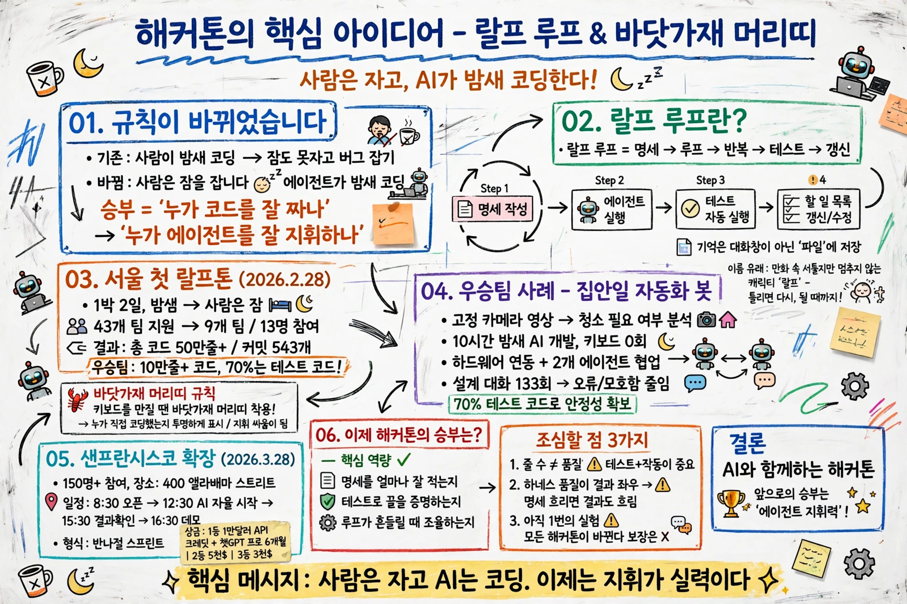
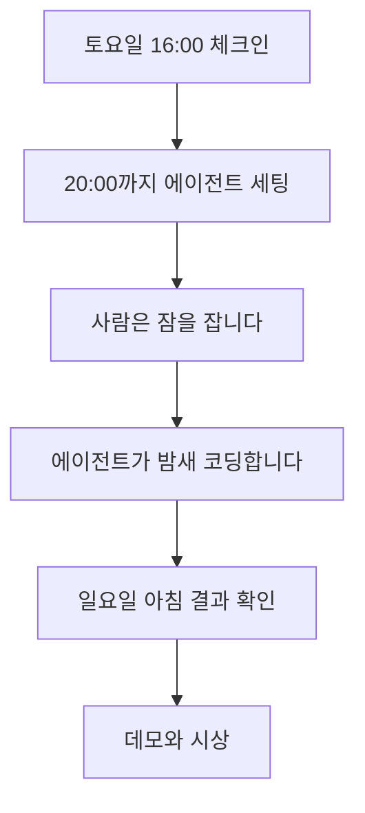
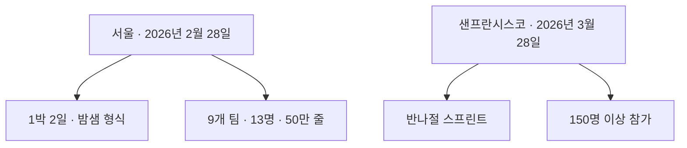
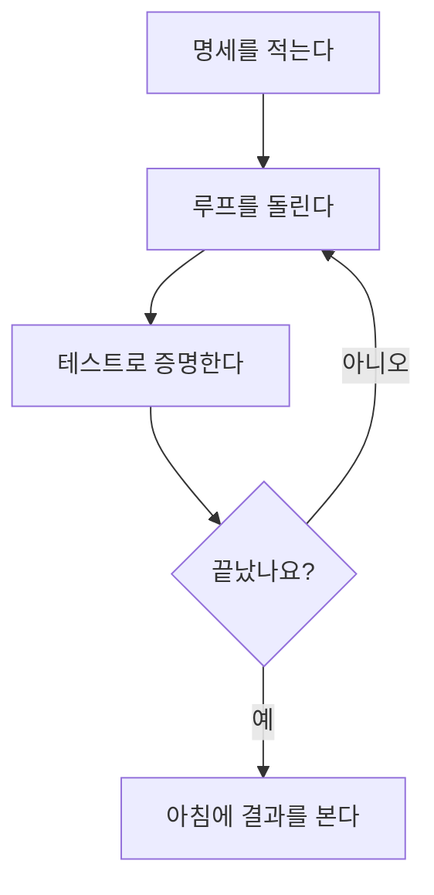

# 해커톤에서 키보드를 만지면 바닷가재 머리띠를 씁니다. 사람은 자고 AI가 10만 줄을 썼습니다

> **Summary**
> 해커톤의 규칙이 바뀌었습니다. 사람이 밤새 코드를 짜는 게 아니라, 에이전트가 밤새 코딩하고 사람은 잡니다. 서울 첫 랄프톤에서 우승팀은 키보드를 한 번도 만지지 않고 10만 줄이 넘는 코드를 만들었고, 그중 70%가 테스트 코드였습니다. 한 달 뒤 샌프란시스코에서는 150명이 넘는 사람들이 같은 규칙으로 모였습니다. 승부는 '누가 코드를 잘 짜나'에서 '누가 에이전트를 잘 지휘하나'로 바뀌었습니다.

---

- 해커톤의 규칙이 바뀌었습니다. 사람이 밤새 코드를 짜는 게 아니라, 에이전트가 밤새 코딩하고 사람은 잡니다.
- 서울 첫 랄프톤에서 우승팀은 키보드를 한 번도 만지지 않고 10만 줄이 넘는 코드를 만들었고, 그중 70%가 테스트 코드였습니다.
- 한 달 뒤 샌프란시스코에서는 150명이 넘는 사람들이 같은 규칙으로 모였습니다. 승부는 "누가 코드를 잘 짜나"에서 "누가 에이전트를 잘 지휘하나"로 바뀌었습니다.

해커톤 마지막 날 새벽, 눈이 감기는데 버그 하나가 안 잡힌 적 있으시죠? 커피를 더 마시고, 키보드를 두드리다 보면 아침이 옵니다. 그런데 어떤 해커톤은 그 밤을 아예 없앴습니다. 사람은 자고, AI가 코딩합니다!

🎥 [동영상 보기](https://www.youtube.com/watch?v=2TLXsxkz0zI)

## 랄프 루프가 뭐길래요?

랄프 루프는 단순합니다. 명세를 적고, 루프를 돌리고, 에이전트가 스스로 일을 이어가게 두는 방식입니다. 같은 지시를 반복해서 먹이고, 끝날 때마다 테스트를 돌리고, 할 일 목록을 갱신합니다. 기억은 대화창이 아니라 파일에 둡니다.

이름은 만화 속 캐릭터에서 왔습니다. 서툴지만 절대 멈추지 않는 아이입니다. 한 번에 한 가지씩, 틀리면 다시, 될 때까지 돕니다. 그 끈기가 이름이 됐습니다.

이 방식이 해커톤의 규칙이 됐습니다. 사람이 코드를 짜는 속도가 아니라, 에이전트를 얼마나 잘 지휘하는지가 승부가 됩니다!

## 서울 첫 랄프톤은 어떻게 돌아갔을까요?

2026년 2월 28일, 서울에서 첫 랄프톤이 열렸습니다. 1박 2일, 밤샘 형식입니다. 토요일 오후 4시에 체크인하고, 저녁 8시까지 에이전트 세션을 세팅합니다. 그리고 잠을 잡니다. 아침에 일어나면 AI가 밤새 만든 결과를 봅니다.

지원한 팀은 43개, 그중 9개 팀 13명이 현장에 모였습니다. 이틀 동안 9개 팀이 만든 코드는 모두 50만 줄이 넘었고, 커밋은 543개였습니다.

규칙은 하나였습니다. 키보드를 만지고 싶으면 바닷가재 머리띠를 써야 합니다!

## 바닷가재 머리띠 규칙이 뭐길래요?

장난처럼 들리지만, 이 규칙이 행사의 핵심입니다. 키보드를 만지는 순간 머리띠를 써야 하니, 누가 손을 댔는지 모두가 알게 됩니다. 경쟁은 "누가 코드를 잘 짜나"가 아니라 "누가 에이전트를 잘 지휘하나"가 됩니다.

샌프란시스코 행사 안내에도 같은 문장이 적혀 있습니다. "노트북을 만지고 싶으면, 먼저 바닷가재 코스튬을 입으세요."

## 우승팀은 무엇을 만들었을까요?

서울 우승팀은 집안일 자동화 봇을 만들었습니다. 집에 달린 고정 카메라 영상을 받아 방이 청소가 필요한지 분석하고, 결과를 알려주는 시스템입니다.

저녁 8시에 세션을 켜고 잤습니다. 머리띠를 한 번도 쓰지 않았습니다. 키보드를 한 번도 만지지 않았다는 뜻입니다. 아침까지 10시간 넘게 에이전트가 만들었습니다. 하드웨어 카메라 연동, 두 개 에이전트의 협업 구조, 판단 로직까지 전부 처음부터 만들었습니다. 코드 10만 줄이 넘었고, 작동했습니다.

숫자가 더 있습니다. 만든 코드의 70%가 테스트 코드였습니다. 개발에 들어가기 전, 에이전트끼리 133번이나 문답을 주고받으며 설계 오류와 모호함을 줄였다고 합니다. 코드를 짜기 전에 설계를 다지는 데 시간을 쓴 것입니다.

이 장면이 저는 가장 인상 깊었습니다. 밤새 일한 주체가 사람이 아니라 루프라는 게, 아침에 열린 결과물 한 장면으로 증명되니까요!

## 샌프란시스코에서는요?

한 달 뒤인 2026년 3월 28일, 샌프란시스코에서도 같은 해커톤이 열렸습니다. 150명이 넘는 사람들이 모였습니다. 장소는 400 앨라배마 스트리트였습니다.

규모가 커진 만큼 후원도 커졌습니다. 오픈AI가 메인 후원사로 함께했고, 국내 투자사들도 이름을 올렸습니다. 연사로는 랄프 루프를 처음 정리한 개발자, 오픈AI의 개발자 경험 총괄, 스탠퍼드 출신 연구자가 나섰습니다.

일정은 서울보다 짧았습니다. 오전 8시 30분에 문을 열고, 정오 12시 30분부터 에이전트가 자율적으로 돌기 시작했습니다. 오후 3시 30분에 노트북을 열고 결과를 확인한 뒤, 오후 4시 30분에 제출하고 데모를 했습니다. 서울이 밤샘이라면, 샌프란시스코는 반나절 스프린트였습니다.

1등 상금은 1만 달러 상당의 API 크레딧과 6개월간의 챗GPT 프로 이용권이었습니다. 2등은 5천 달러, 3등은 3천 달러 상당의 크레딧을 받았습니다. 서울도 같은 상금 구조였습니다.

## 그래서 해커톤의 승부는요?

해커톤의 승부가 바뀌었습니다. "누가 코드를 잘 짜나"에서 "누가 에이전트를 잘 지휘하나"로 말입니다. 명세를 얼마나 잘 적는지, 테스트로 끝을 얼마나 잘 증명하는지, 루프가 흔들릴 때 어디서 멈추고 고치는지가 실력이 됩니다.

서울 우승팀이 남긴 하네스도 화제가 됐습니다. 2등 팀의 하네스도 마찬가지입니다. 행사를 위해 만든 도구가 행사 뒤에도 쓰이기 시작했습니다.

## 조심할 점은 없을까요?

세 가지는 알고 써야 합니다.

첫째, 10만 줄이 곧 좋은 코드는 아닙니다. 줄 수가 아니라, 테스트가 붙어 있고 아침에 작동했는지가 중요합니다. 우승팀 코드의 70%가 테스트였다는 점이 그래서 의미가 있습니다.

둘째, 하네스 품질이 결과를 가릅니다. 명세가 흐리면 루프는 흐릿한 결과를 밤새 만듭니다. 설계 문답 133번이 먼저 있었던 이유입니다.

셋째, 이건 한 번의 실험입니다. 9개 팀의 서울, 150명의 샌프란시스코. 형식이 통했다는 증거는 있지만, 모든 해커톤이 이렇게 바뀔 거라는 보장은 없습니다.

사람이 자는 동안 AI가 코딩하는 해커톤, 아직은 낯설지만 이미 두 도시에서 열렸습니다. 다음 해커톤에서는 키보드를 만지는 사람이 바닷가재 머리띠를 쓰고 있을지도 모릅니다!

