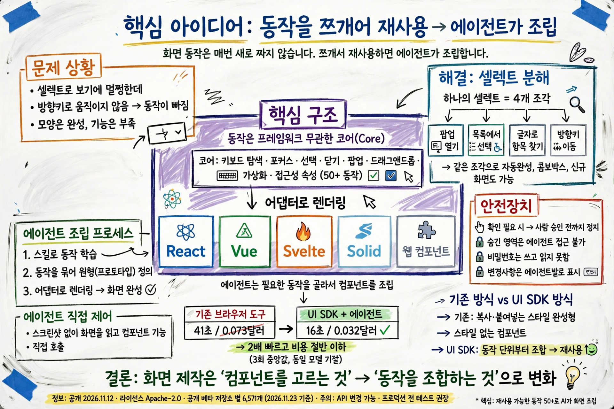
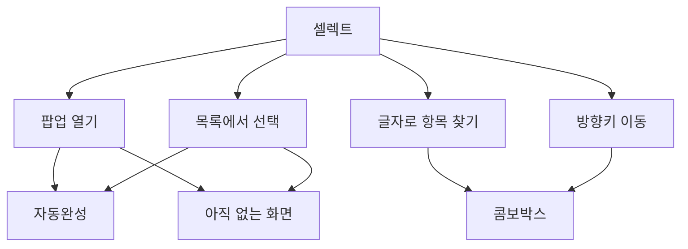
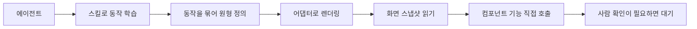

# 화면 동작은 매번 새로 짜지 않습니다. 쪼개서 재사용하면 에이전트가 조립합니다

> **Summary**
> UI SDK는 팝업, 선택, 키보드 탐색, 포커스 관리 같은 화면 동작을 재사용 가능한 조각으로 나눠 에이전트가 필요한 컴포넌트를 조립하도록 합니다. 프레임워크별 어댑터와 에이전트의 화면 직접 조작 기능을 제공해 접근성과 자동화를 돕지만, 공개 베타라 API가 바뀔 수 있어 도입 전 검증이 필요합니다.

---

- 셀렉트 하나를 만드는 데 팝업·선택·키보드 탐색·포커스 관리가 따로 필요합니다. UI SDK는 이 동작들을 쪼개서 재사용 가능한 조각으로 만듭니다.
- 동작은 프레임워크와 무관한 코어에 있고, 어댑터가 다섯 가지 프레임워크로 렌더링합니다. 에이전트는 동작을 골라서 컴포넌트를 조립합니다.
- 만든 화면은 에이전트가 스크린샷 없이 직접 다룹니다. 다만 아직 공개 베타라 API가 바뀔 수 있습니다.

에이전트에게 셀렉트 하나 만들어 달라고 했는데, 보기는 멀쩡한데 방향키로 움직이지 않는 걸 본 적 있으시죠? 목록은 뜨는데 글자를 쳐도 원하는 항목으로 안 가고, 선택한 값은 어디에 저장됐는지 알 수 없을 때가 있습니다. 모양은 완성됐는데 동작이 빠진 겁니다!

🎥 [동영상 보기](https://www.youtube.com/watch?v=0JXoykeUQBM)

## 왜 동작이 먼저일까요?

화면의 겉모습은 이제 에이전트가 곧잘 만듭니다. 문제는 그다음입니다. 팝업을 띄우고, 목록에서 고르고, 키보드로 이동하고, 포커스를 되돌리는 일은 컴포넌트마다 다시 짜야 했습니다. 같은 동작인데도 말이죠. 그래서 공개된 UI SDK는 추상화의 위치를 바꿨습니다. 컴포넌트를 통째로 주는 대신, 컴포넌트를 이루는 동작을 조각으로 나눠서 줍니다. 에이전트는 조각을 골라서 필요한 화면을 조립합니다.

## 셀렉트 하나를 쪼개면 무엇이 나올까요?

셀렉트를 예로 들어보겠습니다. 셀렉트 안에는 팝업을 여는 동작, 목록에서 고르는 동작, 글자를 쳐서 항목을 찾는 동작, 방향키로 이동하는 동작이 들어 있습니다. UI SDK는 각각을 `createPopup`, `createSelection`, `createTypeahead`, `createRovingFocus` 같은 동작으로 나눴습니다. 같은 조각으로 자동완성도 만들고, 콤보박스도 만들고, 아직 아무도 생각하지 못한 화면도 만들 수 있습니다. 조각이 재사용되니까요!

공식 문서에 따르면 동작은 50개가 넘습니다. 키보드 탐색, 포커스, 선택, 닫기, 팝업, 드래그 앤 드롭, 크기 조절, 가상화, 그리고 이 상호작용에 필요한 접근성 속성까지 포함합니다. 동작은 프레임워크에 의존하지 않는 코어 패키지에 있고, 어댑터가 `React`, `Vue`, `Svelte`, `Solid`, 웹 컴포넌트로 렌더링합니다. 동작 자체는 어디서 렌더링하든 같습니다. 완성된 컴포넌트도 함께 제공합니다. `Select`, `Dialog`, `Tabs`, `Rating` 같은 컴포넌트인데, 스타일이 입혀져 있지 않고 별도 설정도 필요 없습니다.

## 에이전트는 어떻게 조립할까요?

사람이 직접 조립 코드를 외울 필요는 없습니다. 에이전트용 스킬을 추가하면 에이전트가 동작 목록과 조합법을 익힙니다. 에이전트는 `definePrimitive`로 동작을 묶어서 원형을 정의하고, `createParts`로 각 프레임워크에 렌더링합니다. 공식 안내 예제인 검색 입력창을 보면, 값이라는 상태 하나와 입력 칸·지우기 버튼이라는 두 개의 부분으로 화면이 완성됩니다. 설치는 패키지 매니저로 코어와 사용하는 프레임워크 어댑터를 받는 방식입니다. 공개 베타라서 API가 정식 출시 전에 바뀔 수 있다는 점은 알고 써야 합니다.

## 만든 화면, 에이전트가 직접 쓸 수 있을까요?

여기가 두 번째 갈림길입니다. UI SDK로 만든 화면은 에이전트가 스크린샷을 찍지 않고 직접 다룰 수 있습니다. 화면을 읽는 도구, 동작을 실행하는 도구, 원하는 부분을 찾는 도구로 화면을 스냅샷처럼 훑고 상태를 읽은 뒤, 컴포넌트 자체의 기능을 호출합니다. 공식 자료에 따르면 스크린샷 기반 방식보다 2배 이상 빠르고 비용은 절반 이하라고 합니다. 다만 이 수치는 공개된 측정 결과라서, 그대로 믿기보다 참고 수치로 보는 편이 좋습니다. 한 가지 측정은 이렇습니다. 프로젝트 설정 화면을 바꾸는 작업에서 브리지를 쓴 에이전트는 16초, 0.032달러가 걸렸고, 일반 브라우저 도구로는 41초, 0.073달러가 걸렸습니다. 세 번 실행한 중앙값이며, 같은 모델을 쓴 결과입니다.

사람이 끼어드는 지점도 정해져 있습니다. 확인이 필요한 동작은 사람이 승인하기 전까지 멈추고, 숨긴 영역은 에이전트가 볼 수 없으며, 비밀번호 같은 입력은 에이전트가 쓰고 읽지는 못합니다. 에이전트가 바꾼 내용은 모두 에이전트발 변경으로 표시돼서, 앱이 구분할 수 있습니다. 브라우저 안에 들어간 에이전트가 컴포넌트 기능을 직접 부를 수 있는 연결 지점도 함께 제공합니다.

## 기존 방식과는 무엇이 다를까요?

이미 쓰던 방식과 비교하면 위치가 보입니다. 복사해서 붙여 넣는 스타일 완성형 컴포넌트는 빠르고 편하지만, 동작을 바꾸려면 코드를 뜯어야 합니다. 스타일 없는 컴포넌트는 접근성과 동작을 갖추고 디자인을 붙이는 방식인데, 컴포넌트 단위로 조합합니다. UI SDK는 한 단계 더 아래로 내려갑니다. 동작 단위부터 조합해서 컴포넌트 자체를 만듭니다. 그래서 에이전트가 만드는 화면도 같은 키보드 지원과 접근성을 갖게 됩니다. 참고로 클라우드 대시보드 스위치 하나로 웹사이트를 에이전트용 도구로 바꾸는 방식과는 갈림길이 다릅니다. 그 글은 기존 웹사이트를 도구로 여는 이야기였고, 이 글은 화면을 만드는 동작 자체를 재사용하는 이야기입니다.

## 어디까지 믿고 써야 할까요?

공식 저장소와 문서를 직접 확인한 기준으로 정리하면, 공개일은 2026년 11월 12일, 라이선스는 `Apache-2.0`, 공개 베타 상태입니다. 저장소 별 개수는 2026년 11월 23일 기준 약 6,571개였습니다. 숫자가 빠르게 오르는 초기 공개 단계라, 지금 숫자는 참고용으로 보는 편이 좋습니다. 베타 약관에 따라 API와 동작이 정식 출시 전에 바뀔 수 있습니다. 그래서 프로덕션에 바로 올리기보다, 에이전트가 화면을 어떻게 조립하는지 시험해 보는 단계로 보는 게 맞습니다. 동작을 쪼개는 발상이 맞다면, 화면을 만드는 일은 컴포넌트를 고르는 일에서 동작을 조합하는 일로 바뀔 겁니다. 그 시작점에 서 있는 도구입니다!

